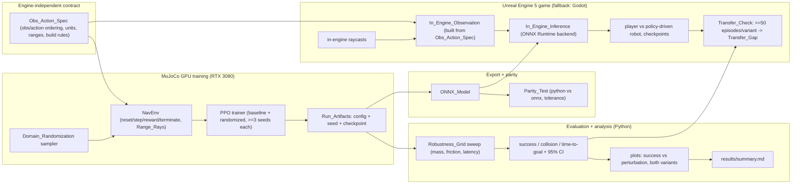

# Design Document

## Overview

Learned Opponents trains a differential-drive navigation Policy with PPO in a GPU-accelerated MuJoCo simulation on one RTX 3080, in two variants — a `Baseline_Variant` with fixed simulation parameters and a `Randomized_Variant` with domain randomization — under one shared `Training_Budget` and at least 3 seeds each. A robustness evaluation sweeps a `Robustness_Grid` of perturbed mass, wheel friction, and latency (including values outside the training ranges) and reports success rate, collision rate, and mean time-to-goal with 95% confidence intervals, plotting both variants on the same axes and writing `results/summary.md`. The trained Policy is exported to ONNX and a parity test proves the exported model matches the Python model within a stated tolerance. Finally, a small Unreal Engine 5 racing level runs the ONNX model in-engine to drive the opponent robot; the in-engine observation vector is rebuilt from in-engine raycasts using the same engine-independent `Obs_Action_Spec` the training environment used, and a transfer check runs ≥50 automated in-game episodes per variant and reports the sim-to-sim `Transfer_Gap` as-is.

Every reported number comes from a single repository command with a fixed seed, recorded with its command, seed, and full commit hash; versions are proven in `docs/ENVIRONMENT.md` and licenses in `THIRD_PARTY.md`; no secret is committed (portfolio rules).

**Requirements coverage:** Overview ties together Requirements 2–11 at a high level; detailed mappings appear per section below.

---

## Framework decision (M0)

The task needs **thousands of parallel environments** and **range (ray) sensors** stepping on a single RTX 3080. Two GPU-accelerated MuJoCo stacks are evaluated for the custom navigation task (Requirement 1.1):

| Framework | GPU backend | Parallelism model | Ray sensors | RTX 30-series note |
| --- | --- | --- | --- | --- |
| MuJoCo Playground (MJX) | JAX / XLA on CUDA (`jax[cuda12]` per the Playground README) | vectorized `vmap` over environments; Playground also offers `--impl warp` | MJX-JAX lists `RANGEFINDER` among supported sensors; MJX-JAX ray casting is slow for meshes, so all arena geometry uses primitive geoms (boxes, cylinders, planes) | On Ampere GPUs (RTX 30/40) the Playground README says to `export JAX_DEFAULT_MATMUL_PRECISION=highest` for reproducibility (Requirement 0.10, 1.5) |
| mjlab (MuJoCo Warp) | NVIDIA Warp on CUDA; PyTorch (cu128 wheels) with `rsl-rl-lib` PPO | kernel-parallel environments | MuJoCo Warp supports rangefinder sensors through BVH-accelerated rays | mjlab declares Linux x86_64 as its required environment |

**Where training runs:** JAX GPU support exists only on Linux (WSL2 is listed as experimental) and mjlab targets Linux x86_64, so both candidates are installed and run inside WSL2 (`Ubuntu-24.04`) on this desktop, using the Windows NVIDIA driver (no Linux NVIDIA driver is installed inside WSL). Each candidate gets its own virtual environment on the Linux filesystem (`~/.venvs/lo-mjx`, `~/.venvs/lo-mjlab`), created with `uv`, so their CUDA libraries never conflict. After the choice, the chosen environment becomes the project environment `~/.venvs/learned-opponents`, and pinned versions go in the repository's dependency file.

**Selection rule:** a framework is eligible only if it passes every smoke-test condition below. Among eligible frameworks, choose the one with the higher measured environment steps per second at the tested parallel count with rays enabled; break ties toward the one whose PPO policy has a working ONNX export path proven by a minimal export in the smoke test.

**Smoke test (Requirement 1.2, 1.3):** build a minimal `Environment` that steps on the GPU with at least **1024 parallel environments** and returns `Range_Rays` readings for each environment. A framework passes only when all hold:
- `nvidia-smi` output is saved in `docs/ENVIRONMENT.md`.
- The minimal environment steps on the GPU at the stated parallel-environment count.
- Each step returns a `Range_Rays` reading per environment.
- The exact framework version and GPU-backend version are recorded in `docs/ENVIRONMENT.md` with a verifiable artifact (package query / docs ref / passing minimal test).

If the chosen framework is MJX, the smoke test runs with `JAX_DEFAULT_MATMUL_PRECISION=highest` and records it (Requirement 1.5, 0.10).

> **M0 outcome (measured on this desktop, RTX 3080 in WSL2):**
> - Command: `bash scripts/smoke_test.sh` (defaults `NUM_ENVS=4096 STEPS=200`, 3 timed repetitions after warm-up), seed 0 for start poses and wheel commands, commit `a7c5aec6769299913c1e38f8950bdbdea072d269`. Raw result: `results/smoke_result.json`; generated table and both `nvidia-smi` captures: `docs/ENVIRONMENT.md` ("M0 smoke test"); logs: `docs/evidence/smoke_mjx.log`, `docs/evidence/smoke_mjlab.log`; versions: `docs/evidence/freeze_lo-mjx.txt`, `docs/evidence/freeze_lo-mjlab.txt`.
> - **Chosen framework: mjlab (MuJoCo Warp)** (Requirement 1.4). Both frameworks passed every smoke-test condition, so the selection rule falls to throughput: MuJoCo Warp stepped **1,713,585** environment steps/s versus **336,509** for MJX-JAX, both at **4096** parallel environments with 24 rangefinders plus one miss probe per environment.
> - Range_Rays: both returned a `(4096, 25)` sensor block on every one of the 200 checked steps (24 rays + the upward miss probe); every ray hit a wall or obstacle; no reading was at or below the chassis radius (no self-hits). The miss probe read exactly `-1.0` in both, which is the miss value the Obs_Action_Spec maps to `max_range_m`.
> - ONNX path (tie-break only, not needed): both passed, max abs difference 6.7e-8 (torch.onnx.export of an rsl-rl style actor) and 1.2e-7 (onnx.helper graph from Brax PPO weights).
> - MJX ran with `JAX_DEFAULT_MATMUL_PRECISION=highest` (Requirement 1.5) and `XLA_PYTHON_CLIENT_PREALLOCATE=false` (WSL2 rejects multi-GB single allocations). Because MJX was not chosen, Requirements 0.10 and 4.7 do not apply to training.

**Rationale (confirmed by evidence):** MJX was first-considered because Playground ships documented examples and a known RTX-30-series precision workaround; mjlab (MuJoCo Warp) was the alternative if Warp's kernel parallelism gave materially higher throughput for the ray-sensor workload on this card. It did, by 5.1x, on an identical arena. A second, qualitative finding points the same way: MJX-JAX 3.16.0 has no cylinder ray routine (cylinders are invisible to its rangefinders), while MuJoCo Warp 3.11.0 ray-casts cylinders, so the design's cylinder obstacles stay cylinders.

**Consequences of the choice for the rest of the design:**
- The simulator is `mjlab.sim.Simulation` (batched MuJoCo Warp worlds with per-world model fields and CUDA-graph stepping). The navigation environment is a torch-vectorized `rsl_rl` `VecEnv` written in this repository on top of it.
- PPO is `rsl_rl` 5.4.2 (`OnPolicyRunner`, `PPO`, `MLPModel` with a state-independent `GaussianDistribution`). The policy's deterministic action is the Gaussian mean, clipped to [-1, 1] by the environment; learned observation normalization (`EmpiricalNormalization`) lives inside the policy.
- Export uses `torch.onnx.export` of normalizer + MLP + clip.

**Requirements coverage:** Requirement 1 (1.1–1.6), 0.10.

---

## Execution environment (where the tasks run)

Kiro runs every task on the owner's Windows 11 desktop with the RTX 3080. Python training, evaluation, export, and parity run inside WSL2; the Unreal game runs on Windows; CI runs the GPU-free tests on GitHub Actions. Nothing is deferred to another machine.

| Item | Value |
| --- | --- |
| Repository root | `C:\dev\Projects\Learned-Opponents` (WSL path `/mnt/c/dev/Projects/Learned-Opponents`) |
| WSL distro | `Ubuntu-24.04`, with `uv` in `~/.local/bin` |
| Python environments | Linux filesystem only: `~/.venvs/lo-mjx`, `~/.venvs/lo-mjlab` (smoke test), then `~/.venvs/learned-opponents` (project). Never inside `/mnt/c`. |
| GPU in WSL | Windows NVIDIA driver, seen in WSL through `nvidia-smi`; no Linux NVIDIA driver inside WSL |
| Unreal Engine | 5.8.x at `C:\Program Files (x86)\UE_5.8`, Visual Studio 2026 |
| Unreal project | `game/LearnedOpponents/LearnedOpponents.uproject`, module `LearnedOpponents`, editor target `LearnedOpponentsEditor`, maps `/Game/Maps/RaceLevel` and `/Game/Maps/TransferArena` |
| Other tools | Git and GitHub CLI on Windows, FFmpeg on Windows |

**Rules that keep an unattended run safe and repeatable**
- **Python runs inside WSL from PowerShell:** `wsl -d Ubuntu-24.04 -- bash -c "cd /mnt/c/dev/Projects/Learned-Opponents && <command>"`, with the project environment's Python called by full path. Every MJX command exports `JAX_DEFAULT_MATMUL_PRECISION=highest` first.
- **Git runs only on Windows** (PowerShell), never inside WSL, so the index is never touched by two Git installs. `.gitattributes` sets `*.sh`, `*.py`, `*.yaml`, `*.md` to `eol=lf` so shell scripts written on Windows still run in bash.
- **One GPU job at a time.** JAX preallocates most GPU memory by default, so training, evaluation, the smoke test, and the Unreal game never run concurrently. Before starting a GPU job, a script checks that no other training/eval process and no `UnrealEditor*` process is running.
- **Long jobs run detached with polling.** Kiro stops a single command after at most 30 minutes. Training, the robustness sweep, cold Unreal builds, and the transfer check start detached (inside WSL: `setsid nohup <cmd> > runs/logs/<name>.log 2>&1 & echo $! > runs/logs/<name>.pid`, ending by writing `runs/logs/<name>.exit`), and the agent polls the log and exit file with short commands. If the process disappears without an exit file, that is an environment failure: record it in `docs/BLOCKERS.md` with the last log lines instead of retrying in a loop.
- **Unreal tools only through scripts:** `powershell -NoProfile -ExecutionPolicy Bypass -File scripts\<name>.ps1`; one Unreal process at a time; `Build.bat ... -WaitMutex`.
- **No `sudo`.** System packages were installed by the owner. A missing one is a blocker, not something to work around.
- **Numbers come from committed code.** Before any run whose numbers are reported, commit the source and record `git rev-parse HEAD`; refuse to report if `git status --porcelain` shows changes outside `results/`, `runs/`, `docs/`, and `README.md`.
- **Retry cap.** A gate or verification that still fails after 3 fix attempts for the same cause is recorded in `docs/BLOCKERS.md` (task, command, exit code, log path, suspected cause) and that task stops. Targets and tests are never loosened to pass (Requirement 0.4).

**Requirements coverage:** 0.1, 0.4, 0.5, 0.6, 0.10, 1.2, 1.3, 10.4.

---

## Architecture



**Requirements coverage:** Requirements 2–11 (end-to-end data path).

---

## Repository layout

The repository remote is `https://github.com/OctaviusLeo/Learned-Opponents.git` (private until released; no public license or packaging — portfolio rules).

```
Learned-Opponents/
├── learned_opponents/                  # Python package (training + env + eval + export)
│   ├── __init__.py
│   ├── spec/                           # engine-independent Obs_Action_Spec (single source of truth)
│   │   ├── obs_action_spec.py          # ordering, units, ranges, build_observation(), build_action()
│   │   └── spec.md                     # human-readable Obs_Action_Spec document
│   ├── env/                            # custom MuJoCo navigation environment
│   │   ├── nav_env.py                  # reset/step/reward/termination, Range_Rays
│   │   ├── model.xml                   # MuJoCo diff-drive robot + arena
│   │   └── obstacles.py                # randomized obstacle generation
│   ├── randomization/                  # domain randomization sampler
│   │   └── domain_rand.py              # mass, friction, motor, sensor noise, action/obs latency
│   ├── train/                          # PPO training entry points
│   │   └── train.py                    # single command: --variant --seed -> Run_Artifacts
│   ├── eval/                           # robustness grid + metrics
│   │   ├── robustness.py               # grid sweep
│   │   ├── metrics.py                  # success/collision/time-to-goal + 95% CI
│   │   └── summary.py                  # writes results/summary.md
│   ├── export/                         # ONNX export + parity fixtures
│   │   ├── to_onnx.py                  # single command export
│   │   └── parity.py                   # python-vs-onnx action comparison
│   └── plotting/
│       └── plots.py                    # success vs perturbation, both variants on same axes
├── tests/                              # pytest + Hypothesis
│   └── __init__.py
├── config/                             # seeded YAML config (versioned)
│   ├── task.yaml                       # arena, goal, rays count, reward term weights
│   ├── train.yaml                      # PPO hyperparameters + Training_Budget
│   ├── domain_rand.yaml                # randomization ranges per parameter
│   └── robustness_grid.yaml            # perturbation grid (incl. out-of-range values)
├── runs/                               # gitignored: Run_Artifacts (config+seed+checkpoint), logs, raw eval output
├── results/                            # generated and committed: summary.md, plots (not hand-edited)
│   ├── models/                         # exported ONNX models, one per (variant, seed); small, committed
│   ├── parity/                         # parity fixtures: observations.npy, actions.npy per model
│   ├── fixtures/obs_cases.json         # Python-generated observation cases for the in-engine test
│   └── transfer/                       # episodes.json (shared layouts), per-episode results
├── game/
│   └── LearnedOpponents/               # Unreal Engine 5 project (fallback: Godot under game/godot/)
│       ├── LearnedOpponents.uproject   # enables the NNERuntimeORT plugin
│       ├── Config/
│       ├── Content/Maps/               # RaceLevel, TransferArena (engine basic shapes only)
│       └── Source/
│           ├── LearnedOpponents.Target.cs
│           ├── LearnedOpponentsEditor.Target.cs
│           └── LearnedOpponents/
│               ├── Obs/                # In_Engine_Observation builder (mirrors Obs_Action_Spec)
│               ├── Inference/          # NNE (ONNX Runtime) wrapper
│               ├── Race/               # level, checkpoints, player + opponent robots
│               ├── Transfer/           # headless transfer harness
│               └── Tests/              # in-engine observation unit tests
├── docs/
│   ├── ENVIRONMENT.md                  # proven versions + nvidia-smi + inference-runtime evidence
│   ├── evidence/                       # smoke-test logs and captures
│   ├── media/gameplay.gif              # captured from the running game
│   └── BLOCKERS.md                     # only created if a gate hits the retry cap
├── scripts/                            # bash (WSL) and PowerShell (Unreal) entry points
├── .github/
│   └── workflows/
│       └── ci.yml                      # GitHub Actions: pytest on push/PR
├── .gitattributes                      # eol=lf for scripts, Python, YAML, Markdown
├── THIRD_PARTY.md                      # third-party names, versions, licenses
└── README.md
```

> Note: the repository root is `C:\dev\Projects\Learned-Opponents`, opened in Kiro as its own workspace with the spec under `.kiro/specs/`. Paths in `tasks.md` are relative to that root. `.gitignore` also lists the Unreal outputs (`Binaries/`, `Intermediate/`, `Saved/`, `DerivedDataCache/`, `*.sln`, `.vs/`), `__pycache__/`, and `runs/`.

**Requirements coverage:** Requirement 0.5, 0.7, 0.8, 0.9; 4.4, 4.6, 10.*, 11.1.

---

## The Obs_Action_Spec (engine-independent contract)

The `Obs_Action_Spec` is the **single source of truth** for the Observation and Action vectors, written once and consumed by both the MuJoCo environment and the game so the game rebuilds exactly what training used (Requirement 2.1, 2.4). It is both executable (`learned_opponents/spec/obs_action_spec.py`) and documented (`spec.md`), and the game's C++ observation builder mirrors it field-for-field.

### Observation vector (Requirement 2.1, 2.3, 3.6)

| Slice | Field | Count | Units | Range | Notes |
| --- | --- | --- | --- | --- | --- |
| rays | `Range_Rays[i]` | `N_rays` (Configured_Value) | meters, normalized to [0,1] by `max_range_m` | [0, 1] | fixed count, identical in env and game |
| goal | `goal_dir_x`, `goal_dir_y` | 2 | unit vector in robot frame | [-1, 1] | direction to goal in the robot's local frame |
| goal | `goal_distance` | 1 | meters, normalized by arena diagonal | [0, 1] | clipped at 1 |
| self | `vel_linear`, `vel_angular` | 2 | `vel_linear / v_max`, `vel_angular / omega_max` | [-1, 1] | robot's own velocity, clipped |

Observation dimension = `N_rays + 5`. Ordering is fixed: `[rays..., goal_dir_x, goal_dir_y, goal_distance, vel_linear, vel_angular]`.

**Frame and geometry rules (these are what make the game rebuild the same vector):**
- **Robot frame:** right-handed, x forward, y left, z up; angles and yaw rate are positive counter-clockwise seen from above. This is MuJoCo's convention. Unreal is left-handed (x forward, y right) in centimeters, so the game converts before building the vector: meters = cm / 100, `y_spec = -y_unreal`, `angle_spec = -yaw_unreal`, `yaw_rate_spec = -yaw_rate_unreal`.
- **Ray layout:** all rays start at the robot center at height `ray_height_m`, horizontal, with angle `theta_i = -ray_fov_deg/2 + i * ray_fov_deg / N_rays` for `i = 0 .. N_rays-1` when `ray_fov_deg = 360`, and `theta_i = -ray_fov_deg/2 + i * ray_fov_deg / (N_rays - 1)` otherwise. Index 0 points straight back (360°) or to the rightmost edge of the fan (less than 360°); indices increase counter-clockwise, so ray `N_rays/2` points straight ahead in the 360° case.
- **No-hit and robot self-hits:** a reading that is negative (MuJoCo rangefinders report a miss with a negative value; prove the exact value with a minimal test), above `max_range_m`, or a hit on the robot's own geometry maps to `max_range_m` before normalizing. Rays must not hit the robot itself in either engine.
- **Velocity normalizers:** `v_max = wheel_radius_m * max_wheel_speed`, `omega_max = 2 * wheel_radius_m * max_wheel_speed / track_width_m`.
- **Goal distance normalizer:** the arena diagonal `sqrt(2) * arena_size_m`.

### Action vector (Requirement 2.2)

| Field | Count | Units | Range | Notes |
| --- | --- | --- | --- | --- |
| `wheel_left`, `wheel_right` | 2 | normalized wheel velocity | [-1, 1] | mapped to rad/s by `max_wheel_speed`; differential drive; clipped to [-1, 1] before use |

The policy is queried once per control step of `control_dt_s` seconds in both engines; the action is held for the whole step.

### Construction rules (Requirement 2.4)

`build_observation(raycasts, goal_pose, robot_vel, config)` maps misses to `max_range_m` and normalizes rays by `max_range_m`, computes the goal direction/distance in the robot frame, and normalizes velocity by `v_max` and `omega_max` — the only engine-specific input is `raycasts`. The game calls the same logic (reimplemented in C++ against the same `spec.md`) so the only intended difference is the raycast source (Requirement 2.4). The spec explicitly excludes any legged-locomotion fields (Requirement 2.5).

**Requirements coverage:** Requirement 2 (2.1–2.5), 3.6.

---

## Navigation environment

### NavEnv
- **Responsibility:** the custom MuJoCo task — a differential-drive `Robot` reaching a goal in an `Arena` with randomized obstacles, steppable on the GPU in parallel.
- **Interface:** `reset(key) -> Observation`, `step(state, Action) -> (Observation, reward, done, info)`, where `info` carries the termination reason (success / collision / timeout).
- **Reset (Requirement 3.1):** place robot and goal, generate randomized obstacles for the episode, return the initial Observation.
- **Step (Requirement 3.2):** apply wheel-velocity commands via differential drive, advance the MuJoCo physics, return next Observation, reward, and termination.
- **Termination:** success when within `arrival_tolerance_m` of the goal (3.3); collision on contact with an obstacle or wall (3.4); timeout at the configured step/time limit (3.5).
- **Rays (Requirement 3.6, 6):** exactly `N_rays` MuJoCo rangefinder readings (one site per ray, its z-axis along `theta_i`), with misses and self-hits mapped to `max_range_m` per the Obs_Action_Spec, each clamped to `max_range_m`.
- **Geometry:** arena walls, floor, obstacles, and robot are primitive geoms only (plane, box, cylinder, capsule), because MJX-JAX ray casting is slow for meshes. Obstacles are axis-aligned boxes and upright cylinders sampled from `config/task.yaml`; layouts with the start or goal inside or within `robot_radius_m + 0.1` m of an obstacle are resampled.
- **Collision:** any contact between a robot geom and an obstacle or wall geom (wheel–floor contacts excluded).
- **Reward (Requirement 3.7):** `r = w_progress * progress_toward_goal + w_success * reached - w_collision * collided` (plus optional control-cost / time penalty), each weight a Configured_Value in `config/task.yaml`.
- **Parallelism (Requirement 3.8):** steps at least the parallel-environment count proven in the smoke test.

### Task configuration defaults (`config/task.yaml`)

These values are fixed before any reported training run and are read by both the MuJoCo environment and the game.

| Field | Default | Notes |
| --- | --- | --- |
| `arena_size_m` | 8.0 | square arena with walls; diagonal 11.31 m |
| `n_obstacles` | [4, 8] | uniform integer per episode |
| `obstacle_size_m` | [0.3, 1.0] | box side or cylinder diameter |
| `robot_radius_m` | 0.15 | collision footprint |
| `wheel_radius_m`, `track_width_m` | 0.05, 0.30 | |
| `max_wheel_speed` | 20.0 rad/s | so `v_max` = 1.0 m/s, `omega_max` = 6.67 rad/s |
| `n_rays`, `ray_fov_deg`, `ray_height_m` | 24, 360, 0.15 | 0.15 m rather than 0.10 m: the 0.05 m-radius wheels top out at 0.10 m and are separate bodies, so a 0.10 m ray plane would graze them; the chassis (same body as the ray sites) is excluded by the rangefinder |
| `max_range_m` | 4.0 | |
| `chassis_mass_kg`, `wheel_mass_kg` | 2.0, 0.1 | nominal masses (scaled by `mass_scale`) |
| `wheel_friction` | 1.0 | wheel sliding friction; the floor has zero friction so MuJoCo's max-combination uses the wheel value (scaled by `friction_scale`) |
| `motor_kv`, `motor_torque_limit_nm` | 0.05, 0.3 | velocity-actuator gain and per-wheel torque limit (both scaled by `motor_strength_scale`) |
| `obstacle_height_m`, `wall_height_m`, `obstacle_kinds` | 0.5, 0.5, [box, cylinder] | |
| `start_goal_clearance_m` | 0.1 | start and goal at least `robot_radius_m + 0.1` m from obstacles and walls |
| `control_dt_s` | 0.05 | 20 Hz policy rate |
| `physics_dt_s` | 0.01 | 5 MuJoCo substeps per control step (implicitfast) |
| `eval_seed` | 20261017 | layouts and noise for every evaluation; never a training seed |
| `episode_limit` | 400 steps | 20 s |
| `min_start_goal_distance_m` | 2.0 | |
| `arrival_tolerance_m` | 0.25 | |
| `nominal_success_target` | 0.80 | Requirement 5.1 |
| `eval_episodes_per_seed` | 1024 | nominal evaluation |

**Requirements coverage:** Requirement 3 (3.1–3.8).

---

## Domain randomization

At episode reset the `Randomized_Variant` samples each parameter from a configured range in `config/domain_rand.yaml` (Requirement 4.2). The `Baseline_Variant` holds all of them at their nominal values.

| Parameter | Applied to | Sampled at |
| --- | --- | --- |
| `mass` | robot body mass | episode reset |
| `wheel_friction` | wheel-ground friction | episode reset |
| `motor_strength` | wheel actuator gain | episode reset |
| `sensor_noise` | additive Gaussian noise on `Range_Rays` | sigma sampled at episode reset; noise drawn every step from the seeded stream |
| `action_latency` | delay queue on applied Action | queue length sampled at episode reset |
| `observation_latency` | delay queue on returned Observation | queue length sampled at episode reset |

Every parameter is sampled at episode reset (Requirement 4.2). Latency is a fixed-length delay queue for the episode; action and observation latency use the same mechanism in the two directions. All sampling draws from the run seed so a given `(seed, config)` reproduces the randomization exactly (Requirement 0.2, 0.3).

**Default ranges (`config/domain_rand.yaml`; mass, friction, and motor strength are scale factors on the nominal value):**

| Parameter | Nominal | Randomized range |
| --- | --- | --- |
| `mass_scale` | 1.0 | [0.8, 1.2] |
| `friction_scale` | 1.0 | [0.6, 1.2] |
| `motor_strength_scale` | 1.0 | [0.8, 1.2] |
| `sensor_noise_sigma_m` | 0.0 | [0.0, 0.05] |
| `action_latency_steps` | 0 | [0, 2] |
| `observation_latency_steps` | 0 | [0, 2] |

**Requirements coverage:** Requirement 4.2; 0.2, 0.3.

---

## Training pipeline

### PPO trainer
- **Responsibility:** train the Policy with PPO; identical `Training_Budget` for both variants (Requirement 4.1).
- **Interface (Requirement 4.6):** one command — `python -m learned_opponents.train --variant {baseline|randomized} --seed <int>` — writes `Run_Artifacts` to `runs/<variant>/seed<seed>/` containing the resolved config, the seed, and the checkpoint.
- **Seeds (Requirement 4.3):** at least 3 seeds per variant; the exact seeds are Configured_Values: `seeds.baseline = [0, 1, 2]`, `seeds.randomized = [0, 1, 2]`, and a separate `seeds.pilot = [100]` that is never reported as a result.
- **Config (Requirement 4.5):** `Training_Budget`, PPO hyperparameters, and the randomization ranges are versioned in `config/train.yaml` and `config/domain_rand.yaml`.
- **Precision (Requirement 4.7, 0.10):** on MJX/RTX 3080, runs set `JAX_DEFAULT_MATMUL_PRECISION=highest`.
- **Choosing the budget before the reported runs:** the M0 smoke test measures environment steps per second. A pilot baseline run (seed 100) is used to pick `training_budget_steps` and the PPO hyperparameters so that one run takes at most 60 minutes on this GPU and the pilot clears `nominal_success_target`; if no setting reaches the target within 60 minutes, the best setting found is kept and the shortfall is reported. The budget, hyperparameters, and task config are then frozen and committed before any reported run, and both variants use them unchanged (Requirement 4.1). Tuning on the baseline pilot is stated as a limitation.
- **Reproducibility tolerance (Requirement 0.3):** the pilot is trained twice with the same seed and config; the difference between the two runs' nominal success rates is reported as the measured training reproducibility on this GPU. Evaluating a fixed checkpoint with a fixed evaluation seed must reproduce its success counts exactly.

### Policy network
A small MLP mapping the `N_rays + 5` Observation to the 2-dim Action. The architecture is fixed in config and reused across both variants so the only training-time difference is the randomization. The same network is what gets exported to ONNX. The deterministic action used for evaluation, export, and the game is the policy's mean action after any squashing or clipping the framework applies (for example tanh), and any observation normalization the PPO implementation learns is part of the policy.

**Requirements coverage:** Requirement 4 (4.1–4.7), 0.10.

---

## Nominal success target (M2)

- `config/task.yaml` states the **nominal success-rate target** as a Configured_Value: 0.80 (Requirement 5.1).
- The `Baseline_Variant` is evaluated at nominal parameters over 1024 episodes per seed (3,072 pooled, a 95% Wilson half-width of about ±1.4 points at a true rate of 0.8) with deterministic actions and a fixed evaluation seed; the Measured_Value `Success_Rate` is reported with its 95% confidence interval against the target, pooled and per seed (Requirement 5.2).
- If the target is missed, the real value and the cause are reported; the target and evaluation are not loosened (Requirement 5.3, 0.4).

**Requirements coverage:** Requirement 5 (5.1–5.3), 0.4.

---

## Robustness evaluation (M3)

### Robustness grid
`config/robustness_grid.yaml` defines perturbation values for **mass**, **wheel friction**, and **latency**, each including at least one value **outside** the training randomization range (Requirement 6.1). The sweep evaluates every variant at every grid cell.

The sweep varies one parameter at a time with the others at nominal, so each plot shows one parameter. A grid latency value applies to both the action and the observation delay queues. Default values:

| Parameter | Grid values | Training range | Outside the range |
| --- | --- | --- | --- |
| `mass_scale` | 0.5, 0.8, 1.0, 1.2, 1.5, 2.0 | [0.8, 1.2] | 0.5, 1.5, 2.0 |
| `friction_scale` | 0.3, 0.6, 0.9, 1.2, 1.5 | [0.6, 1.2] | 0.3, 1.5 |
| `latency_steps` | 0, 1, 2, 3, 4, 6 | [0, 2] | 3, 4, 6 |

`episodes_per_cell` = 1024 per seed (3,072 pooled per variant and cell). Worst case, with every episode timing out, the full sweep is 17 cells × 2 variants × 3 seeds × 1024 episodes × 400 steps = 41.8 million environment steps (at most 3.5 minutes at 200,000 steps/s; the real throughput comes from the M0 smoke test and the measured wall time is recorded).

### Metrics with confidence intervals
For each (variant, cell) over a stated number of episodes (Requirement 6.2):
- `Success_Rate` and `Collision_Rate` are proportions; their 95% CIs use the Wilson score interval (appropriate for binomial proportions, including near 0 and 1).
- mean `Time_To_Goal` over successful episodes with a 95% CI (normal/t interval on the mean).
- Results aggregate across the ≥3 seeds per variant by pooling episodes across seeds; the Summary_File states this method and also lists each seed's own success rate per cell, because the pooled interval covers episode sampling only, not seed-to-seed training variation (Requirement 6.3).

### Plots and summary
`plotting/plots.py` saves one plot per perturbed parameter with `Success_Rate` versus that parameter and **both variants on the same axes** (Requirement 6.4). `eval/summary.py` writes `results/summary.md` with the full grid for both variants (Requirement 6.5). The whole sweep runs from one command and every number is recorded with command, seed, and commit (Requirement 6.6, 0.1).

**Requirements coverage:** Requirement 6 (6.1–6.6), 0.1.

---

## ONNX export and parity (M4)

### Export
`python -m learned_opponents.export.to_onnx --checkpoint <path> --out <path.onnx>` exports the Policy network to ONNX (Requirement 7.1). The ONNX input is the `N_rays + 5` Observation and the output is the 2-dim Action, both conforming to the Obs_Action_Spec (Requirement 7.6).

- **What the graph contains:** the whole deterministic policy, so the game feeds it the raw Obs_Action_Spec vector and uses its output directly: any learned observation normalization (mean/std), the MLP, and the deterministic action head (for example tanh or clipping to [-1, 1]). Exporting only the MLP would silently break parity and transfer.
- **I/O contract:** one input named `obs`, `float32[1, N_rays + 5]`; one output named `action`, `float32[1, 2]`; standard ops only (MatMul/Gemm, Add, Sub, Div, Tanh, the activation used). The opset and exporter versions are recorded in `docs/ENVIRONMENT.md`.
- **How:** with `torch.onnx.export` if the chosen framework is PyTorch (mjlab), or by building the graph from the trained weights with `onnx.helper` (or a proven JAX exporter) if it is JAX; the parity test decides whether the export is correct.
- **Which models:** one ONNX file per (variant, seed), written to `results/models/<variant>_seed<seed>.onnx` and committed (an MLP of this size is small).

### Parity fixtures and test
A fixed set of Observations is saved alongside the Actions the Python Policy produces for them (Requirement 7.2): 1,000 observations per model, half taken from nominal evaluation rollouts and half sampled uniformly within the Obs_Action_Spec ranges, saved to `results/parity/<variant>_seed<seed>/`. The `Parity_Test` feeds those Observations through both the Python Policy (the framework's own deterministic inference function, not a re-implementation) and the ONNX_Model (via ONNX Runtime on CPU) and compares the Actions (Requirement 7.3). The tolerance is max absolute action difference ≤ `1e-4`, and the test passes only when every compared Action is within it (Requirement 7.4). On failure it reports the Observation index and the magnitude of the largest disagreement (Requirement 7.5). The full test runs locally in the project environment; CI runs the fixture half (saved actions versus ONNX Runtime output), which needs no GPU framework.

**Requirements coverage:** Requirement 7 (7.1–7.6).

---

## Game, in-engine inference, and transfer check (M5)

### Game
A small Unreal Engine 5 level: the player drives one `Robot` and a Policy-driven `Robot` races to checkpoints through obstacles (Requirement 8.1). Levels use engine basic shapes and engine materials only, created without the editor UI (an editor Python script run headless, proven on this engine version first, or actors spawned from C++ at `BeginPlay` on a minimal saved map). Each in-game robot uses kinematic differential-drive motion with the same `wheel_radius_m`, `track_width_m`, and `max_wheel_speed` as `config/task.yaml`, moved with swept collision so contact with an obstacle or wall is detected; this dynamics difference from MuJoCo is part of what the transfer check measures.

### In-engine inference
The exported ONNX_Model drives the opponent (Requirement 8.2). Unreal 5.8 ships the **NNERuntimeORT** plugin ("ONNX Runtime backed runtime for NNE, accelerated by the CPU and DirectML execution providers"; NNE is labeled Beta). The game enables that plugin in the `.uproject`, adds the `NNE` module to `Build.cs`, creates a `UNNEModelData` at runtime with `Init("onnx", <file bytes>, {})` from `results/models/<variant>_seed<seed>.onnx` (so no editor import is needed), gets the runtime with `UE::NNE::GetRuntime<INNERuntimeCPU>("NNERuntimeORTCpu")`, checks `CanCreateModelCPU`, then `CreateModelCPU`, `CreateModelInstanceCPU`, `SetInputTensorShapes`, and `RunSync` once per control step. The runtime actually used, its exact version, and a verifiable artifact (a passing in-engine inference test on a known input) are recorded in `docs/ENVIRONMENT.md` (Requirement 8.3).

If NNE cannot load or run the model on this engine version, try linking ONNX Runtime's prebuilt Windows x64 C++ library directly into the Unreal module before giving up on Unreal. **Godot is the recorded fallback** only if both fail: record the blocking problem and build the Game + inference in Godot instead (Requirement 8.6). Godot has no built-in ONNX runtime, so the fallback must add one and record which.

### In-engine observation
`game/.../Obs/` rebuilds the Observation from in-engine raycasts using the Obs_Action_Spec construction rules — same ray count, same angles, same ordering, same units and ranges, same normalization, and the Unreal-to-spec frame conversion — so it matches the training Observation (Requirement 8.4). Unit tests feed known raycast inputs and assert the built vector matches the Obs_Action_Spec (Requirement 8.5). The engine-agnostic check (Property 3) reads `results/fixtures/obs_cases.json`, written by Python from a fixed seed (≥100 cases of raw ranges, poses, and velocities with the vectors `build_observation` returns), and requires the C++ builder to match within `1e-5`. A separate in-engine test places obstacles at known distances and checks the traced ranges.

### Transfer check
`scripts/run_transfer.*` runs **≥50 automated in-Game episodes per variant** (Requirement 9.1), reports each variant's in-Game `Success_Rate` with a 95% CI (Requirement 9.2), and reports the `Transfer_Gap` = MuJoCo `Success_Rate` − in-Game `Success_Rate` for each variant (Requirement 9.3). The gap is reported as-is; nothing is tuned to shrink it (Requirement 9.4). One command, every number recorded with command/seed/commit (Requirement 9.5).

- **Same episodes in both engines:** Python writes 50 episode layouts (arena, obstacles, start pose, goal) from a fixed seed to `results/transfer/episodes.json`. The game's `TransferArena` map and the MuJoCo environment both load these exact layouts, at nominal parameters, so the gap compares the same tasks.
- **Episodes per variant:** each of the 3 seed policies runs all 50 layouts, so each variant has 150 in-game episodes (95% Wilson half-width about ±6 points at a true rate of 0.8) and 150 matching MuJoCo episodes. The MuJoCo `Success_Rate` in the gap is the success rate on these same 150 episodes, and the per-layout pairs are saved.
- **Headless and frame-rate independent:** the harness runs the game with `-game -nullrhi -unattended` and steps each episode manually at `control_dt_s` in a loop (trace rays, build the observation, run inference, apply a swept move), so results do not depend on frame rate. Termination uses the same success, collision, and timeout rules as MuJoCo.

**Requirements coverage:** Requirement 8 (8.1–8.6), Requirement 9 (9.1–9.5).

**Requirements coverage:** Requirement 8 (8.1–8.6), Requirement 9 (9.1–9.5).

---

## Data Models

### Configuration models

**TaskConfig (`config/task.yaml`)** — arena, goal, rays, reward (Requirement 3.6, 3.7, 5.1).

| Field | Type | Notes |
| --- | --- | --- |
| `n_rays`, `ray_fov_deg`, `ray_height_m` | int, float, float | fixed `Range_Rays` count and layout; identical in env and game (Requirement 2.3, 3.6). |
| `max_range_m` | float | ray clamp + observation normalizer. |
| `max_wheel_speed`, `wheel_radius_m`, `track_width_m` | float | action mapping and velocity normalizers. |
| `arena_size_m`, `n_obstacles`, `obstacle_size_m`, `robot_radius_m`, `min_start_goal_distance_m` | mixed | arena and layout sampling. |
| `control_dt_s` | float | policy step length in both engines. |
| `arrival_tolerance_m` | float | goal-reached threshold (Requirement 3.3). |
| `episode_limit` | int | step/time limit for timeout (Requirement 3.5). |
| `reward.w_progress` / `w_success` / `w_collision` | float | reward term weights (Requirement 3.7). |
| `nominal_success_target` | float [0,1] | M2 target (Requirement 5.1). |
| `eval_episodes_per_seed` | int | episodes per seed for the nominal evaluation. |

Defaults are in "Task configuration defaults" above.

**TrainConfig (`config/train.yaml`)** — PPO + budget (Requirement 4.1, 4.5).

| Field | Type | Notes |
| --- | --- | --- |
| `training_budget_steps` | int | identical for both variants (Requirement 4.1). |
| `num_parallel_envs` | int | ≥ smoke-test count (Requirement 3.8). |
| `ppo.*` | mixed | learning rate, clip, entropy coeff, batch/minibatch, epochs, gamma, gae lambda. |
| `policy.hidden_sizes` | int[] | MLP architecture (fixed across variants). |
| `seeds.baseline` / `seeds.randomized` | int[] | ≥3 seeds each (Requirement 4.3); default `[0, 1, 2]`. |
| `seeds.pilot` | int[] | budget and hyperparameter pilot only, never reported; default `[100]`. |
| `max_minutes_per_run` | int | 60; the pilot picks a budget that fits. |

**DomainRandConfig (`config/domain_rand.yaml`)** — per-parameter ranges (Requirement 4.2); defaults in "Domain randomization".

| Field | Type | Notes |
| --- | --- | --- |
| `mass_scale` | [min, max] | scale on nominal robot mass. |
| `friction_scale` | [min, max] | scale on nominal wheel friction. |
| `motor_strength_scale` | [min, max] | scale on nominal actuator gain. |
| `sensor_noise_sigma_m` | [min, max] | ray-noise sigma range. |
| `action_latency_steps` | [min, max] | action delay-queue length range. |
| `observation_latency_steps` | [min, max] | observation delay-queue length range. |

**RobustnessGridConfig (`config/robustness_grid.yaml`)** — perturbation sweep (Requirement 6.1); defaults in "Robustness evaluation".

| Field | Type | Notes |
| --- | --- | --- |
| `mass_scale` | float[] | perturbation values; includes ≥1 outside the training range. |
| `friction_scale` | float[] | perturbation values; includes ≥1 outside the training range. |
| `latency_steps` | int[] | perturbation values (both delay queues); includes ≥1 outside the training range. |
| `episodes_per_cell` | int | episodes per seed for each cell's CI (1024). |

### Run artifacts and results

**Run_Artifacts** — written per training run to `runs/<variant>/seed<seed>/` (Requirement 4.4).

| Field | Type | Notes |
| --- | --- | --- |
| `config.yaml` | file | fully resolved config used for the run. |
| `seed` | int | the run seed. |
| `checkpoint` | file | saved Policy parameters. |
| `commit` | string | full commit hash (reproducibility). |

**RobustnessCellResult** — one row per (variant, parameter, value) in `results/summary.md` (Requirement 6.2).

| Field | Type | Notes |
| --- | --- | --- |
| `variant` | string | baseline / randomized. |
| `parameter` | string | mass / wheel_friction / latency. |
| `value` | float | grid value (flagged if outside training range). |
| `success_rate` + `ci95` | float, [lo, hi] | Wilson interval. |
| `collision_rate` + `ci95` | float, [lo, hi] | Wilson interval. |
| `mean_time_to_goal` + `ci95` | float, [lo, hi] | t interval on the mean. |
| `n_episodes` | int | episodes behind the estimate. |

**TransferResult** — one row per variant (Requirement 9.2, 9.3).

| Field | Type | Notes |
| --- | --- | --- |
| `variant` | string | baseline / randomized. |
| `mujoco_success_rate` + `ci95` | float, [lo, hi] | MuJoCo, nominal parameters, on the same 50 layouts × 3 seeds as the game. |
| `ingame_success_rate` + `ci95` | float, [lo, hi] | 150 in-game episodes (≥50 required). |
| `transfer_gap` | float | mujoco − in-game, reported as-is. |
| `n_episodes` | int | episodes behind each rate. |

### ONNX / parity

**ONNX_Model I/O** — input `obs` `float32[1, N_rays + 5]`, output `action` `float32[1, 2]`, matching the Obs_Action_Spec (Requirement 7.6). **Parity fixtures** — `results/parity/<variant>_seed<seed>/observations.npy` and `actions.npy` (the Python Policy's actions for those observations), compared with a stated tolerance (Requirement 7.2, 7.4).

**Requirements coverage:** 2.3, 3.3–3.8, 4.1–4.5, 6.1, 6.2, 7.2, 7.4, 7.6, 9.2, 9.3.

---

## Correctness Properties

*A property is a characteristic or behavior that should hold true across all valid executions of a system — essentially, a formal statement about what the system should do. Properties serve as the bridge between human-readable specifications and machine-verifiable correctness guarantees.*

The following properties cover the pure, input-varying logic of the system (observation/action construction, environment termination logic, domain-randomization sampling, metrics and confidence intervals, ONNX parity, in-engine observation construction). GPU throughput, engine timing, and configuration-presence criteria are covered by smoke, integration, and example tests in the Testing Strategy, not by property tests.

### Property 1: Observation layout conforms to the Obs_Action_Spec
*For any* valid raycasts, goal pose, and robot velocity, the Observation built by `build_observation` has dimension `N_rays + 5`, every field lies within its declared range, and the slice ordering matches the Obs_Action_Spec exactly.
**Validates: Requirements 2.1, 2.3, 3.6**

### Property 2: Action layout conforms to the Obs_Action_Spec
*For any* Action produced by the Policy, the Action has dimension 2 and both wheel-velocity components lie within [-1, 1].
**Validates: Requirements 2.2**

### Property 3: Observation construction is engine-agnostic
*For any* set of raycast inputs, the Python `build_observation` and the game's in-engine observation builder, given the same raycasts, goal pose, and velocity, produce observation vectors equal within a stated numeric tolerance.
**Validates: Requirements 2.4, 8.4, 8.5**

### Property 4: Reset returns a valid initial observation
*For any* reset seed, the Environment's returned initial Observation conforms to the Obs_Action_Spec and contains exactly `N_rays` ray readings each within [0, max_range_m].
**Validates: Requirements 3.1, 3.6**

### Property 5: Termination is mutually exclusive and reason-tagged
*For any* episode, exactly one termination reason (success, collision, or timeout) is reported when the episode ends, success is reported only within the arrival tolerance, and timeout is reported only at the configured limit.
**Validates: Requirements 3.3, 3.4, 3.5**

### Property 6: Reward is a weighted sum of its configured terms
*For any* step, the reward equals the configured weighted sum of its terms (progress, success, collision), so zeroing a weight removes exactly that term's contribution.
**Validates: Requirements 3.7**

### Property 7: Domain randomization samples within configured ranges
*For any* randomization config and seed, every sampled parameter (mass, wheel friction, motor strength, sensor noise, action latency, observation latency) lies within its configured range, and the baseline variant leaves all parameters at nominal.
**Validates: Requirements 4.2**

### Property 8: Randomization is reproducible under a fixed seed
*For any* seed and randomization config, two sampling runs produce identical parameter draws.
**Validates: Requirements 0.3, 4.2**

### Property 9: Success/collision confidence intervals are valid proportions
*For any* count of successes out of n episodes, the reported Success_Rate and Collision_Rate lie in [0, 1] and their 95% Wilson confidence intervals contain the point estimate and lie within [0, 1].
**Validates: Requirements 6.2, 9.2**

### Property 10: Achieved time-to-goal CI brackets the mean
*For any* set of successful-episode times, the reported mean Time_To_Goal lies within its reported 95% confidence interval.
**Validates: Requirements 6.2**

### Property 11: Grid includes out-of-training-range values
*For any* robustness grid config, each perturbed parameter's value list contains at least one value outside the training randomization range for that parameter.
**Validates: Requirements 6.1**

### Property 12: ONNX parity holds within tolerance
*For any* saved parity Observation, the Action from the ONNX_Model and the Action from the Python Policy agree within the stated tolerance.
**Validates: Requirements 7.3, 7.4**

### Property 13: Parity failure reports the worst disagreement
*For any* set of Observations where at least one Action exceeds tolerance, the Parity_Test fails and reports the offending Observation index and the magnitude of the largest disagreement.
**Validates: Requirements 7.5**

### Property 14: Transfer gap equals the measured difference
*For any* pair of MuJoCo and in-game Success_Rates for a variant, the reported Transfer_Gap equals MuJoCo minus in-game, with no adjustment.
**Validates: Requirements 9.3, 9.4**

**Requirements coverage:** 0.3, 2.1–2.4, 3.1, 3.3–3.7, 4.2, 6.1, 6.2, 7.3–7.5, 8.4, 8.5, 9.2, 9.3, 9.4.

---

## Error Handling

- **Invalid configuration:** reject the configuration, emit an error naming the out-of-range or missing parameter, and do not start the run.
- **Smoke-test failure:** if both frameworks fail, report that none passed and record each framework's first-failing condition in `docs/ENVIRONMENT.md` (Requirement 1.6).
- **Missed nominal target (M2):** report the actual Measured_Value and the identified cause; never loosen the target or evaluation (Requirement 5.3, 0.4).
- **Parity failure:** fail the test and report the Observation index and the largest action disagreement (Requirement 7.5).
- **Unreal inference blocked:** record the blocking problem in `docs/ENVIRONMENT.md` and build the Game + inference in the Godot fallback (Requirement 8.6).
- **Transfer gap:** report the gap as measured; do not tune the Game, Policy, or evaluation to shrink it (Requirement 9.4).
- **Failed run or missed target generally:** report the actual result and the identified cause in the run output; never loosen a target or test to force a pass (Requirement 0.4).

---

## Testing Strategy

### Dual approach
- **Property tests** verify the universal properties above across many generated inputs. The pure logic is Python (environment logic, observation/action construction, randomization, metrics, parity), tested with pytest + **Hypothesis**; the in-engine observation builder is tested in the game's native test framework.
- **Unit / example / integration tests** cover specific examples, edge cases, configuration presence, GPU stepping, and engine/runtime behavior that is not input-varying.

### Property-based testing (where it applies)
- **Python (pytest / Hypothesis):** Properties 1, 2, 4, 5, 6, 7, 8, 9, 10, 11, 12, 13, 14 are implemented with **Hypothesis** (a mature Python property-based testing library — not written from scratch), configured to run **≥100 iterations** per property, each tagged in a comment with `Feature: learned-opponents, Property {number}: {property_text}`.
- **Game side (native tests):** Property 3 (engine-agnostic observation construction) is implemented as an Unreal Automation test that runs the C++ builder over the ≥100 Python-generated cases in `results/fixtures/obs_cases.json` and compares within `1e-5`, tagged `Feature: learned-opponents, Property 3`. All project tests are registered under the `LearnedOpponents.` prefix and run headless with `UnrealEditor-Cmd.exe <uproject> -ExecCmds="Automation RunTests LearnedOpponents;Quit" -unattended -nopause -nosplash -nullrhi -testexit="Automation Test Queue Empty" -ReportExportPath=<dir> -log` from `scripts/run_ue_tests.ps1`, which exits 0 only if every test passed and at least one ran.
- Each property is implemented by a **single** property-based test.

### Unit, example, and integration tests
- **GPU smoke (single execution):** the M0 minimal environment steps at ≥1024 parallel environments and returns Range_Rays (Requirement 1.2); the chosen framework and backend versions are recorded (Requirement 1.3).
- **Environment examples:** goal-reached success at arrival tolerance (3.3); collision termination (3.4); timeout at the limit (3.5); reward term wiring (3.7).
- **Training examples:** one-command launch writes Run_Artifacts for a variant+seed (4.4, 4.6); the MJX precision env var is set on RTX 3080 (4.7, 0.10). Full training runs are executed locally and their results recorded with command/seed/commit — not in CI.
- **Export/parity:** the ONNX input/output shapes conform to the Obs_Action_Spec (7.6); parity passes within tolerance on saved fixtures (7.3, 7.4).
- **Game integration:** in-engine observation unit tests on known raycasts (8.5); ≥50-episode transfer harness runs and emits per-variant success rate + gap (9.1–9.3).

### Continuous integration
- **GitHub Actions** (`.github/workflows/ci.yml`) runs the pytest suite on every push and pull request; a failing pytest run reports a failed status (Requirement 10.4, 10.5).
- **GPU training and the game are out of scope for hosted CI:** MuJoCo GPU training and UE5/Godot runs are impractical on hosted runners, so those run **locally** and their results are recorded with command, seed, and commit hash. CI runs the pure-Python logic (observation/action construction, randomization, metrics, summary, parity on saved fixtures). The README states the exact command for each suite (Requirement 10.6).
- **Keeping CI GPU-free:** tests that need the GPU framework are marked `@pytest.mark.gpu` and CI runs `pytest -m "not gpu"`; locally, in WSL, the full `pytest` runs. CI installs a small pinned `requirements-ci.txt` (no CUDA wheels). Modules imported by CI-run tests must not import JAX, Warp, or PyTorch at module level. The red-run check uses a temporary branch `ci-fail-check` that is deleted afterwards; run status is read with `gh run list` / `gh run watch`.

**Requirements coverage:** Requirement 10 (10.1–10.6), 0.9.

---

## Measured targets & end-to-end gate

- **M2 nominal target:** the Baseline_Variant's nominal Success_Rate is measured over the configured episode count and reported with its 95% CI against `nominal_success_target` (Requirement 5.2).
- **M3 robustness:** every grid cell's success/collision/time-to-goal with 95% CIs for both variants, written to `results/summary.md` (Requirement 6.2, 6.5).
- **M4 parity:** every parity Observation's action agrees within the stated tolerance (Requirement 7.4).
- **M5 transfer:** ≥50 in-game episodes per variant; per-variant in-game success rate + Transfer_Gap reported as-is (Requirement 9.1–9.4).
- Every reported number is recorded with its command, seed, and full commit hash; `results/summary.md` is generated, not hand-edited (Requirement 0.1).

**Gameplay GIF:** `scripts/capture_gif.ps1` launches `RaceLevel` windowed with the opponent under ONNX inference and the player robot driven by a scripted demo controller (stated in the README caption), captures 8 to 12 seconds with FFmpeg `gdigrab`, scales to 640 px wide, and writes `docs/media/gameplay.gif` under 10 MB.

**End-to-end gate (end of M5 — Requirement 11.4):** the pipeline runs train → robustness → ONNX export → parity → in-engine play → transfer check, with every reported number produced by a repository command. Measured results are reported as whatever they actually are; if a target is missed, the real value and cause are reported and no target or test is loosened (Requirement 0.4).

**Requirements coverage:** Requirement 5.2, 6.2, 6.5, 7.4, 9.1–9.4, 11.4, 0.1, 0.4.

---

## Risks and limitations

Carried into the README known-limitations section (Requirement 11.1):

- **Sim-to-sim, not sim-to-real.** The transfer check moves from MuJoCo to a game engine, not to hardware; the Transfer_Gap is a sim-to-sim result and is reported as such.
- **Domain randomization may not close the transfer gap.** Randomization is expected to improve robustness, but whether it reduces the in-game Transfer_Gap is a measured outcome, not an assumption; it is reported as-is.
- **RTX 30-series precision workaround.** On MJX the `JAX_DEFAULT_MATMUL_PRECISION=highest` setting trades some throughput for reproducibility; the achieved throughput is measured, not assumed.
- **Determinism is bounded.** GPU floating-point reductions and framework nondeterminism mean "identical seed/config" reproduces results only within a stated tolerance, not byte-for-byte (Requirement 0.3); the tolerance is stated alongside each reproduced number.
- **Unreal in-engine inference is version-dependent.** Whether Unreal's Neural Network Engine with an ONNX Runtime backend supports the installed Unreal version is verified in M5; if it blocks, the Game falls back to Godot and the blocker is recorded (Requirement 8.3, 8.6). NNE is labeled Beta in the UE 5.8 documentation.
- **GPU training inside WSL2.** JAX lists NVIDIA GPU support on WSL2 as experimental, and NVIDIA documents limited pinned memory and no full unified memory in WSL2; the smoke test proves the chosen stack works here before anything relies on it.
- **Hyperparameters tuned on the baseline pilot.** The budget and PPO settings are chosen on a baseline pilot run and reused for the randomized variant, which may favor the baseline slightly.
- **Different dynamics in the game.** The in-game robot is kinematic, so mass, friction, and motor strength have no in-game counterpart; the transfer gap mixes raycast, collision, and dynamics differences.
- **Seed-to-seed variation.** Pooled confidence intervals describe episode sampling with 3 seeds per variant; per-seed rates are listed so training variability stays visible.

---

## Design decisions and rationale

- **One engine-independent Obs_Action_Spec** — the Observation/Action contract is written once and consumed by both the trainer and the game, so the game rebuilds exactly what training used and the transfer gap measures policy transfer rather than observation mismatch (Requirement 2.4, 8.4).
- **Navigation, not legged locomotion** — navigation's inputs (ray distances, goal direction) and outputs (wheel velocities) can be reproduced from in-engine raycasts without MuJoCo, which is what makes the in-engine opponent possible (Requirement 2.5).
- **Same budget, same architecture, randomization as the only variable** — isolating domain randomization as the single difference lets the robustness delta be attributed to it (Requirement 4.1).
- **Confidence intervals on every rate** — Wilson intervals for proportions and t intervals for the mean time-to-goal, so robustness and transfer claims carry stated uncertainty rather than point estimates (Requirement 6.2, 9.2).
- **Generated results only** — `results/summary.md`, plots, and parity fixtures are produced by repository commands, never hand-edited, so every README number is reproducible (Requirement 0.1).
- **Godot fallback recorded up front** — the inference-runtime risk is identified in the design so M5 is not blocked if Unreal inference does not support the installed version (Requirement 8.6).

- **Same episodes in both engines** — the transfer check runs identical layouts in MuJoCo and in the game, so the gap compares the same tasks rather than two different task distributions (Requirement 9.3).
- **The exported model is the whole deterministic policy** — normalization and the action head are inside the ONNX graph, so parity, the game, and training all use the same function (Requirement 7.3, 7.6).

Execution is autonomous: every task in `tasks.md` is implemented by the agent, and each milestone ends with an automated gate instead of an owner review stop. Gate failures that survive the retry cap are recorded in `docs/BLOCKERS.md` for the owner.
