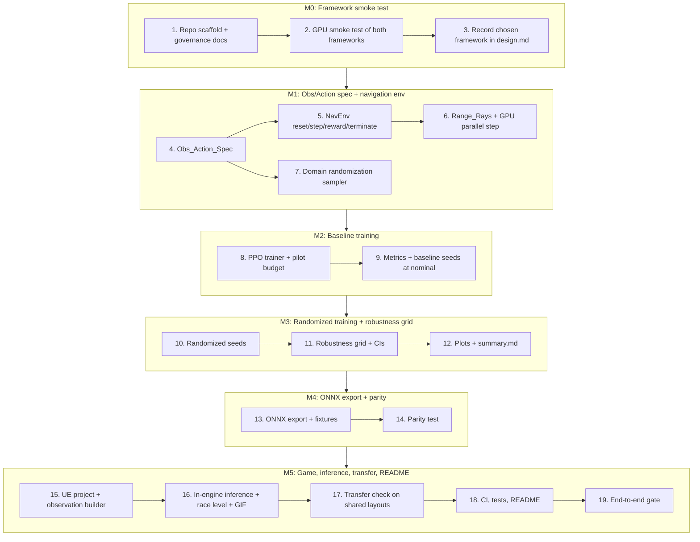

# Implementation Plan: Learned Opponents

## Overview

This plan converts the design into incremental, code-focused tasks organized under milestones **M0–M5**. It is written to run **autonomously** with Kiro's "Run all tasks": every task is agent-implementable, and every milestone ends with an **automated verification gate** (a single repository command whose exit status decides pass/fail) instead of an owner review stop. The agent moves on when the gate exits 0. If a gate exits non-zero, the agent fixes the cause and re-runs it, up to 3 fix attempts for the same failure; after that it records the failure in `docs/BLOCKERS.md` (task, command, exit code, log path, suspected cause) and stops that task. Targets and tests are never loosened to make a gate pass.

Training, environment, evaluation, export, and parity are Python (pytest + Hypothesis), run inside WSL2. The game and its in-engine observation builder are Unreal Engine 5.8 C++ on Windows, with Godot as the recorded fallback. Property-based tests follow the design's Testing Strategy: Hypothesis with ≥100 iterations for Python, and the Python-generated fixture cases (≥100) for the game-side test. Every reported result comes from a single repository command with a fixed seed, recorded with its command, seed, and full commit hash, from committed code; versions go in `docs/ENVIRONMENT.md` and licenses in `THIRD_PARTY.md`; no secrets are committed. Commit after each task (`task <id>: <summary>`).

**Where this runs:** Kiro executes these tasks on the owner's Windows 11 desktop with the RTX 3080 (design.md, "Execution environment"). Python commands run in WSL `Ubuntu-24.04` from PowerShell; Unreal commands run on Windows through `scripts/*.ps1`; only one GPU job runs at a time; anything longer than a few minutes runs detached and is polled.

## Milestone Dependency Graph



## Tasks

### M0 — Framework smoke test

- [x] 1. Scaffold the repository and governance documents
  - Create the directory layout from the design: `learned_opponents/` (with `spec/`, `env/`, `randomization/`, `train/`, `eval/`, `export/`, `plotting/`), `tests/`, `config/`, `runs/`, `results/`, `game/LearnedOpponents/`, `docs/`, `scripts/`, `.github/workflows/`.
  - Add `.gitignore` listing every secret-bearing file (env files, local tokens) and generated heavy artifacts (`runs/`, large checkpoints) so no secret is tracked; confirm no secrets are committed (_Requirements: 0.8_).
  - Create `docs/ENVIRONMENT.md` skeleton with sections for each tool/library/API version plus its verifiable artifact (package query / docs ref / passing minimal test), including a line for `JAX_DEFAULT_MATMUL_PRECISION` (_Requirements: 0.5, 0.6, 0.10_).
  - Create `THIRD_PARTY.md` skeleton with columns name / version / license identifier (_Requirements: 0.7_).
  - Create `README.md` skeleton with placeholders for the research question, method, robustness plots, transfer table, gameplay GIF, reproduction steps, test commands, and known limitations (_Requirements: 11.1, 10.6_).
  - Add `pyproject.toml`/`requirements` with pinned versions for the Python stack (framework, numpy, onnx/onnxruntime, pytest, hypothesis, pyyaml, matplotlib).
  - Initialize git and set remote `https://github.com/OctaviusLeo/Learned-Opponents.git` (private; no public license or packaging).
  - Demo/verify: `ls -R` shows the full layout; `git remote -v` shows the remote; `git check-ignore` confirms secret files are ignored.
  - _Requirements: 0.5, 0.6, 0.7, 0.8, 0.10, 11.1_

- [x] 2. Run the GPU framework smoke test and record the environment
  - [x] 2.1 Prepare the repository and implement `scripts/smoke_test.sh` (run inside WSL) (_Requirements: 1.1, 1.2, 1.3, 1.5_).
    - Extend `.gitignore` with the Unreal and Python outputs listed in the design (`Binaries/`, `Intermediate/`, `Saved/`, `DerivedDataCache/`, `*.sln`, `.vs/`, `__pycache__/`, `runs/`); add `.gitattributes` with `*.sh`, `*.py`, `*.yaml`, `*.yml`, `*.md`, `*.json` set to `text eol=lf`; if `THIRD_PARTY.md` exists only under `docs/`, move it to the repository root.
    - Create two uv virtual environments on the Linux filesystem: `~/.venvs/lo-mjx` (MuJoCo Playground with `jax[cuda12]`, as its README instructs) and `~/.venvs/lo-mjlab` (mjlab with its CUDA PyTorch extra). Record every installed version (`uv pip freeze`) in `docs/evidence/`.
    - For each framework, the script builds a minimal arena (primitive geoms only) with a differential-drive robot carrying `n_rays` rangefinders, steps ≥1024 parallel environments on the GPU for at least 200 steps, asserts a Range_Rays block of shape `(num_envs, n_rays)` every step, measures environment steps per second after warm-up, and proves the miss value of a rangefinder that hits nothing. The MJX run exports `JAX_DEFAULT_MATMUL_PRECISION=highest` first.
    - For each framework, also prove an ONNX path: export that framework's policy network type (a tiny untrained MLP is enough) and check ONNX Runtime output against the framework output.
    - Capture `nvidia-smi` on Windows and inside WSL into `docs/ENVIRONMENT.md`. Write `results/smoke_result.json` with, per framework: pass/fail per condition, parallel count, steps/s, versions, the command, and the commit.
    - If both frameworks fail, record each one's first-failing condition in `docs/ENVIRONMENT.md` and exit non-zero (_Requirements: 1.6_).
    - _Requirements: 1.1, 1.2, 1.3, 1.5, 1.6, 0.10_
  - [x] 2.2 Run the smoke test, choose the framework, and create the project environment
    - Run `scripts/smoke_test.sh` detached and poll it. Apply the design's selection rule to `results/smoke_result.json`.
    - Create `~/.venvs/learned-opponents` for the chosen framework plus onnx, onnxruntime, pytest, hypothesis, pyyaml, matplotlib, numpy; pin exact versions in the repository's dependency file; add a GPU-free `requirements-ci.txt` for CI; record versions and licenses in `docs/ENVIRONMENT.md` and `THIRD_PARTY.md`.
    - Demo/verify: `docs/ENVIRONMENT.md` contains both `nvidia-smi` captures, the step throughput, the parallel-env count, confirmation that Range_Rays were returned, and the precision setting if MJX was chosen.
    - _Requirements: 1.2, 1.3, 1.5, 0.5, 0.6, 0.7, 0.10_

- [x] 3. Record the chosen framework and evidence in design.md
  - Fill the "M0 outcome" block in `design.md` from `results/smoke_result.json`: chosen framework, measured parallel-env count and step throughput, confirmation Range_Rays were returned, and (if applicable) each framework's first-failing condition (_Requirements: 1.4_).
  - Add the generating command, seed, and full commit hash alongside any number cited (_Requirements: 0.1_).
  - Demo/verify: the `design.md` M0 section shows a concrete chosen framework with evidence paths that exist on disk.
  - _Requirements: 1.4, 0.1_

- [x] 3g. **Automated gate (M0):** run `scripts/verify_m0.sh`, which checks the layout, `.gitignore` and `.gitattributes` coverage, `git remote`, that `results/smoke_result.json` names a passing framework, and that `~/.venvs/learned-opponents/bin/python -c "import learned_opponents"` succeeds; proceed when it exits 0. No manual review stop.

### M1 — Obs/Action spec, navigation environment, randomization

- [x] 4. Define the engine-independent Obs_Action_Spec
  - [x] 4.1 Implement `learned_opponents/spec/obs_action_spec.py` with `build_observation(raycasts, goal_pose, robot_vel, config)` and `build_action(...)`, fixing the observation ordering `[rays..., goal_dir_x, goal_dir_y, goal_distance, vel_linear, vel_angular]` (dim `N_rays + 5`), the 2-dim wheel-velocity action, units, ranges, and every frame and geometry rule in design.md (robot frame, ray angles and ordering, miss and self-hit mapping, velocity and distance normalizers); write `spec/spec.md` to match, including the Unreal conversion rules. Write `config/task.yaml` with the design defaults. The spec excludes legged-locomotion fields (_Requirements: 2.1, 2.2, 2.3, 2.4, 2.5_).
    - This module must import only numpy and the standard library, so CI can test it.
    - Demo/verify: a sample call returns a vector of the right length with every field inside its declared range.
  - [x] 4.2 Write Hypothesis property tests for the Obs_Action_Spec
    - **Property 1: Observation layout conforms to the Obs_Action_Spec** (≥100 iterations).
    - **Property 2: Action layout conforms to the Obs_Action_Spec** (≥100 iterations).
    - _Properties: 1, 2 — Requirements: 2.1, 2.2, 2.3_

- [x] 5. Implement the navigation environment
  - [x] 5.1 Implement `env/nav_env.py`, `env/model.xml`, and `env/obstacles.py` with the chosen framework: `reset`/`step`/reward/termination for the differential-drive robot in an arena with randomized primitive obstacles; reset places robot+goal and obstacles and returns the initial Observation; step applies wheel-velocity commands and returns next Observation/reward/termination; success within arrival tolerance, collision on robot contact with an obstacle or wall, timeout at the limit; reward is the configured weighted sum of progress/success/collision terms (_Requirements: 3.1, 3.2, 3.3, 3.4, 3.5, 3.7_).
    - Keep layout sampling, termination decision, and reward arithmetic as pure functions so CI can test them; also expose `reset_from_layout(layout)` so the transfer check can replay fixed layouts.
    - Demo/verify: a one-command headless rollout reaches a goal (success), hits an obstacle (collision), and times out, each tagged with the correct reason.
  - [x] 5.2 Write Hypothesis property tests for env reset, termination, and reward
    - **Property 4: Reset returns a valid initial observation** (≥100 iterations; marked `gpu` if it needs the simulator).
    - **Property 5: Termination is mutually exclusive and reason-tagged** (≥100 iterations).
    - **Property 6: Reward is a weighted sum of its configured terms** (≥100 iterations).
    - _Properties: 4, 5, 6 — Requirements: 3.1, 3.3, 3.4, 3.5, 3.7_

- [x] 6. Implement Range_Rays and GPU parallel stepping
  - [x] 6.1 Wire the rangefinder sensors per the Obs_Action_Spec ray layout so each Observation carries exactly `N_rays` readings, misses and self-hits mapped to `max_range_m`, and confirm the env steps on the GPU for at least the smoke-test parallel-env count (_Requirements: 3.6, 3.8_).
    - Demo/verify: a batched step over `num_parallel_envs` returns a Range_Rays block of shape `(num_parallel_envs, N_rays)` with values in `[0, max_range_m]`; a test scene with one wall at a known distance returns that distance on the expected ray index.
  - [x] 6.2 Write a smoke/example test for parallel GPU stepping and ray shape
    - Confirm the ray count/shape, the known-distance ray, and the parallel-env count (single execution, marked `gpu`).
    - _Requirements: 3.6, 3.8_

- [x] 7. Implement the domain-randomization sampler
  - [x] 7.1 Implement `randomization/domain_rand.py` sampling mass, wheel friction, motor strength, sensor noise sigma, action latency, and observation latency at episode reset from `config/domain_rand.yaml` (write it with the design defaults) for the randomized variant; baseline leaves all at nominal; all draws derive from the run seed (_Requirements: 4.2, 0.2, 0.3_).
    - Demo/verify: sampling with a fixed seed twice yields identical draws; every draw sits inside its configured range; baseline draws equal nominal.
  - [x] 7.2 Write Hypothesis property tests for randomization bounds and reproducibility
    - **Property 7: Domain randomization samples within configured ranges** (≥100 iterations).
    - **Property 8: Randomization is reproducible under a fixed seed** (≥100 iterations).
    - _Properties: 7, 8 — Requirements: 4.2, 0.3_

- [x] 7g. **Automated gate (M1):** run the full `pytest` in the project environment inside WSL (including `gpu` tests) and `pytest -m "not gpu"` with only `requirements-ci.txt` installed in a throwaway venv; proceed when both exit 0. No manual review stop.

### M2 — Baseline training

- [x] 8. Implement the PPO trainer and fix the training budget
  - [x] 8.1 Implement `train/train.py` as a single command `python -m learned_opponents.train --variant {baseline|randomized} --seed <int>` that trains the Policy with PPO under the configured `Training_Budget` and writes `Run_Artifacts` (resolved config, seed, checkpoint, commit) to `runs/<variant>/seed<seed>/`; on MJX/RTX 3080 set `JAX_DEFAULT_MATMUL_PRECISION=highest`; `Training_Budget`, PPO hyperparameters, and seeds are read from `config/train.yaml` (_Requirements: 4.1, 4.4, 4.5, 4.6, 4.7, 0.10_).
    - Add `scripts/train.sh <variant> <seed>`, which starts training detached with log, pid, and exit files as the design describes, and refuses to start a reported seed if the tree is dirty or another GPU job is running.
    - Demo/verify: one command trains a short baseline run and leaves `runs/baseline/seed<seed>/` with config, seed, checkpoint, and commit; the env var is set under MJX.
  - [x] 8.2 Write an example test for Run_Artifacts and the precision setting
    - Confirm a launched run writes the artifacts and that the MJX precision env var is set (single execution, marked `gpu`).
    - _Requirements: 4.4, 4.7, 0.10_
  - [x] 8.3 Run the pilot and freeze the budget
    - Train the pilot seed (100, never reported) to choose `training_budget_steps` and PPO hyperparameters per the design rule (at most 60 minutes per run on this GPU, pilot reaching `nominal_success_target` if possible). Train the final pilot setting twice and record the difference in nominal success as the measured training reproducibility tolerance (_Requirements: 0.3_).
    - Freeze and commit `config/train.yaml`, `config/task.yaml`, and `config/domain_rand.yaml`; no later task may change them.
    - _Requirements: 4.1, 4.5, 0.3_

- [x] 9. Evaluate the baseline at nominal parameters
  - [x] 9.1 Implement `eval/metrics.py` (success/collision rates with 95% Wilson CIs; mean time-to-goal with a t CI) and a nominal-evaluation entry point `python -m learned_opponents.eval.robustness --nominal` that evaluates deterministic actions with a fixed evaluation seed over `eval_episodes_per_seed` episodes per seed and reports the pooled and per-seed Success_Rate with 95% CIs against `nominal_success_target` (_Requirements: 5.1, 5.2, 5.3, 0.4_).
    - `metrics.py` imports only numpy and the standard library.
  - [x] 9.2 Write Hypothesis property tests for the confidence intervals
    - **Property 9: Success/collision confidence intervals are valid proportions** (≥100 iterations).
    - **Property 10: Achieved time-to-goal CI brackets the mean** (≥100 iterations).
    - _Properties: 9, 10 — Requirements: 5.2, 6.2_
  - [x] 9.3 Train the reported baseline seeds and evaluate them at nominal
    - Train baseline seeds 0, 1, 2 one after another with `scripts/train.sh`, polling each to completion. Run the nominal evaluation and write the result, with command, seeds, and commit, to `results/summary.md`. If the target is missed, report the real value and cause; do not loosen anything (_Requirements: 4.3, 5.2, 5.3, 0.4_).
    - _Requirements: 4.3, 4.4, 5.2, 5.3, 0.1, 0.4_

- [x] 9g. **Automated gate (M2):** check that `runs/baseline/seed{0,1,2}/` hold complete Run_Artifacts, that `results/summary.md` holds the nominal result with command, seed, and commit, and that the full `pytest` passes; proceed when all exit 0. A missed target is reported, not a gate failure. No manual review stop.

### M3 — Randomized training and robustness grid

- [x] 10. Train the randomized variant across seeds
  - Train randomized seeds 0, 1, 2 one after another under the identical frozen `Training_Budget`, writing all `Run_Artifacts`; add `scripts/train_all.sh`, which reproduces all six reported runs from one command; record the launching command, seeds, and commit (_Requirements: 4.1, 4.3, 4.4_).
  - Demo/verify: `runs/baseline/` and `runs/randomized/` each hold 3 seed directories with checkpoints.
  - _Requirements: 4.1, 4.3, 4.4_

- [x] 11. Implement the robustness grid and metrics
  - [x] 11.1 Implement `eval/robustness.py` sweeping `config/robustness_grid.yaml` (write it with the design defaults: one parameter at a time, each with values outside the training range) and reporting per cell the Success_Rate, Collision_Rate, and mean Time_To_Goal, each with a 95% CI over `episodes_per_cell` per seed, pooled across the 3 seeds, plus each seed's own success rate, with the aggregation method stated (_Requirements: 6.1, 6.2, 6.3_).
    - Run it detached and poll; record the wall time.
    - Demo/verify: a one-command grid run on the checkpoints emits per-cell metrics with CIs for both variants, including out-of-range cells.
  - [x] 11.2 Write Hypothesis property test for the out-of-range grid guarantee
    - **Property 11: Grid includes out-of-training-range values** (≥100 iterations over generated grid/range configs).
    - _Properties: 11 — Requirements: 6.1_

- [x] 12. Generate robustness plots and the summary file
  - Implement `plotting/plots.py` (Success_Rate vs each perturbed parameter, both variants on the same axes, CIs as error bars, out-of-range values marked) and `eval/summary.py` so one `eval.robustness` invocation saves plots to `results/` and writes `results/summary.md` (generated, never hand-edited); every number recorded with command/seed/commit (_Requirements: 6.4, 6.5, 6.6, 0.1_).
  - Demo/verify: a single command produces the per-parameter plots and `results/summary.md` with the full grid for both variants.
  - _Requirements: 6.4, 6.5, 6.6, 0.1_

- [x] 12g. **Automated gate (M3):** run the full `pytest` and check that `results/summary.md` holds every grid cell for both variants and that one plot per parameter exists; proceed when all exit 0. No manual review stop.

### M4 — ONNX export and parity

- [x] 13. Export the policy to ONNX and save parity fixtures
  - [x] 13.1 Implement `export/to_onnx.py` as a single command exporting a checkpoint's whole deterministic policy (normalization, MLP, action head) to an ONNX_Model with input `obs` `float32[1, N_rays + 5]` and output `action` `float32[1, 2]` (conforming to the Obs_Action_Spec); export all six checkpoints to `results/models/<variant>_seed<seed>.onnx`; save the parity fixtures described in design.md to `results/parity/<variant>_seed<seed>/` (_Requirements: 7.1, 7.2, 7.6_).
    - Demo/verify: the command writes the `.onnx` files and the fixtures; loading each model reports the expected input/output names and shapes.
  - [x] 13.2 Write an example test for ONNX I/O shape conformance
    - Confirm each exported model's input/output names and shapes match the Obs_Action_Spec (single execution; runs in CI).
    - _Requirements: 7.6_

- [x] 14. Implement the parity test
  - [x] 14.1 Implement `export/parity.py` feeding the saved Observations through the Python Policy (the framework's own deterministic inference) and the ONNX_Model (ONNX Runtime, CPU) and comparing Actions against the stated tolerance (max absolute difference ≤ 1e-4); pass only when every Action is within tolerance; on failure report the Observation index and the largest disagreement (_Requirements: 7.3, 7.4, 7.5_).
    - Demo/verify: `python -m learned_opponents.export.parity` passes on all six exported models and, when fed a deliberately mismatched model, fails and names the worst observation.
  - [x] 14.2 Write Hypothesis property tests for parity
    - **Property 12: ONNX parity holds within tolerance** (≥100 iterations over saved/generated observations).
    - **Property 13: Parity failure reports the worst disagreement** (≥100 iterations).
    - _Properties: 12, 13 — Requirements: 7.3, 7.4, 7.5_

- [x] 14g. **Automated gate (M4):** run `python -m learned_opponents.export.parity` on all six models and the full `pytest`; proceed when both exit 0. No manual review stop.

### M5 — Game, in-engine inference, transfer check, README

- [x] 15. Create the Unreal project and the in-engine observation builder
  - [x] 15.1 Create the minimal UE 5.8 C++ project from files, without the editor wizard: `game/LearnedOpponents/LearnedOpponents.uproject` (EngineAssociation `5.8`, one Runtime module `LearnedOpponents`, plugin `NNERuntimeORT` enabled), both `Target.cs` files, the module `Build.cs` (depends on `NNE`, `Json`, `JsonUtilities`), and the primary module source. Add `scripts/build_game.ps1` (`Build.bat LearnedOpponentsEditor Win64 Development ... -WaitMutex`, background with polling for a cold build) and `scripts/run_ue_tests.ps1` (the headless command in design.md, exits 0 only when every test passed and at least one ran). Record UE, Visual Studio, MSVC, and Windows SDK versions in `docs/ENVIRONMENT.md` (_Requirements: 0.5, 0.6, 10.3_).
    - Demo/verify: the editor target builds with zero errors; `scripts/run_ue_tests.ps1` runs a trivial passing test and exits 0.
  - [x] 15.2 Implement the Game's `Obs/` builder that reconstructs the Observation from in-engine raycasts using the Obs_Action_Spec construction rules (same `N_rays`, angles, ordering, units, ranges, normalization, and the Unreal-to-spec frame conversion); add in-engine unit tests over known raycast inputs, an Automation test that places obstacles at known distances and checks the traced ranges, and the **Property 3** test against `results/fixtures/obs_cases.json`, which `scripts/make_obs_fixtures.sh` writes from Python with a fixed seed (≥100 cases) (_Requirements: 8.4, 8.5, 2.4_).
    - **Property 3: Observation construction is engine-agnostic**: every fixture case matches the Python vector within 1e-5.
    - Demo/verify: `scripts/run_ue_tests.ps1` exits 0.
    - _Properties: 3 — Requirements: 2.4, 8.4, 8.5, 10.3_

- [x] 16. Run in-engine inference and build the race level
  - [x] 16.1 Implement `Inference/` with NNE as design.md describes (runtime `NNERuntimeORTCpu`, model data created at runtime from `results/models/*.onnx` with `UNNEModelData::Init`). Add an Automation test that runs each exported model in-engine on its parity observations and requires the actions to match the saved Python actions within 1e-4. Record the runtime used, its version, and that passing test as the verifiable artifact in `docs/ENVIRONMENT.md`. If NNE cannot load or run the models, follow the design's fallback order (ONNX Runtime linked directly into the Unreal module, then Godot) and record the blocker (_Requirements: 8.2, 8.3, 8.6_).
    - Demo/verify: the in-engine inference test passes for all six models.
  - [x] 16.2 Build `/Game/Maps/RaceLevel`: the player drives one robot (keyboard), the policy-driven robot races to checkpoints through obstacles, both with kinematic differential-drive motion from `config/task.yaml`; levels use engine basic shapes only and are created without the editor UI. Add `scripts/capture_gif.ps1` as design.md describes and write `docs/media/gameplay.gif` (_Requirements: 8.1, 8.2_).
    - Demo/verify: a short `-game` launch on this desktop shows the opponent moving under ONNX inference and reaching checkpoints; `docs/media/gameplay.gif` exists and is under 10 MB.
    - _Requirements: 8.1, 8.2_

- [x] 17. Implement the transfer check
  - [x] 17.1 Write `results/transfer/episodes.json` (50 layouts from a fixed seed with `env/obstacles.py`), evaluate all six policies on those layouts in MuJoCo at nominal parameters with deterministic actions, implement the headless frame-rate-independent `Transfer/` harness and `/Game/Maps/TransferArena` in Unreal as design.md describes, and implement `scripts/run_transfer.ps1`, which runs all six policies on all 50 layouts in-game (150 episodes per variant), saves per-episode results, and writes each variant's in-Game Success_Rate with a 95% CI, the matching MuJoCo Success_Rate on the same episodes, and the Transfer_Gap to `results/summary.md`, reported as-is with nothing tuned to shrink it; every number recorded with command/seed/commit (_Requirements: 9.1, 9.2, 9.3, 9.4, 9.5_).
    - Demo/verify: one command produces the transfer table in `results/summary.md` with 150 episodes per variant.
  - [x] 17.2 Write Hypothesis property test for the transfer-gap computation
    - **Property 14: Transfer gap equals the measured difference** (≥100 iterations).
    - _Properties: 14 — Requirements: 9.3, 9.4_

- [ ] 18. Wire CI, finish the tests, and assemble the README
  - [x] 18.1 Add GitHub Actions CI (`.github/workflows/ci.yml`) that installs `requirements-ci.txt` and runs `pytest -m "not gpu"` on push (all branches) and pull request, reporting a failed status when any test fails (_Requirements: 10.4, 10.5_).
    - Demo/verify: push and confirm a green run with `gh run watch`; then push a commit with one intentionally failing test to a temporary branch `ci-fail-check`, confirm that run is red, and delete the branch locally and on GitHub. Never force-push and never rewrite history.
  - [ ] 18.2 Write pytest unit tests for metrics, summary, and plotting wiring
    - Cover CI formatting and summary generation on synthetic results with known answers (runs in CI).
    - _Requirements: 10.2_
  - [ ] 18.3 Fill the README: research question, method, robustness plots, transfer table (both sourced from the generated `results/summary.md`, not hand edits), the gameplay GIF with its caption, per-number reproduction steps, per-suite test commands (WSL `pytest`, CI `pytest -m "not gpu"`, `scripts/run_ue_tests.ps1`, parity), and the design's known limitations; cite each result with its command, seed, and full commit hash (_Requirements: 11.1, 11.2, 11.3, 10.6_).
    - If a target is missed, report the real value and cause; do not loosen any target or test (_Requirements: 11.4, 0.4_).
    - Demo/verify: every number in the README matches `results/summary.md` and has its command, seed, and commit beside it.

- [ ] 19. **Automated checkpoint — end-to-end gate:** confirm train → robustness → ONNX export → parity → in-engine play → transfer check with the repository commands: the full `pytest` in WSL, `scripts/run_ue_tests.ps1`, the parity command on all six models, a green CI run on the latest pushed commit, and a script check that `results/summary.md` holds the nominal, robustness, and transfer sections, that `docs/media/gameplay.gif` exists, and that the README numbers match the summary. The checkpoint passes when all exit 0. The agent fixes failures and re-runs within the retry cap; it does not pause for input (_Requirements: 11.4, 0.1, 0.4_).

## Notes

- Tasks marked `*` are optional test sub-tasks and are not implemented by the task-execution agent. No task in this plan is marked `*`: every test task is required, because Requirement 10 requires these tests.
- The plan is fully agent-driven: there are no owner-implemented (`[ME]`) tasks and no manual review stops. Every milestone ends with an **automated gate**; failures that survive 3 fix attempts are recorded in `docs/BLOCKERS.md` and stop that task.
- GPU jobs (smoke test, training, evaluation, export, the game) never run at the same time, and no two tasks build the Unreal project at once; the dependency graph below runs them one per wave.
- Every reported number comes from a single repository command with a fixed seed, recorded with command, seed, and full commit hash, from committed code; versions live in `docs/ENVIRONMENT.md`, licenses in `THIRD_PARTY.md`, and no secrets are committed.
- GPU training and the game run locally (not in hosted CI); CI runs the GPU-free tests (`pytest -m "not gpu"`).
- Determinism under a fixed seed is bounded by GPU/framework nondeterminism and is held to the measured tolerance from task 8.3, not byte-for-byte (Requirement 0.3).

## Task Dependency Graph

```json
{
  "waves": [
    { "id": 0, "tasks": ["1"] },
    { "id": 1, "tasks": ["2.1"] },
    { "id": 2, "tasks": ["2.2"] },
    { "id": 3, "tasks": ["3"] },
    { "id": 4, "tasks": ["3g"] },
    { "id": 5, "tasks": ["4.1"] },
    { "id": 6, "tasks": ["4.2", "7.1"] },
    { "id": 7, "tasks": ["7.2"] },
    { "id": 8, "tasks": ["5.1"] },
    { "id": 9, "tasks": ["5.2"] },
    { "id": 10, "tasks": ["6.1"] },
    { "id": 11, "tasks": ["6.2"] },
    { "id": 12, "tasks": ["7g"] },
    { "id": 13, "tasks": ["8.1"] },
    { "id": 14, "tasks": ["8.2"] },
    { "id": 15, "tasks": ["9.1"] },
    { "id": 16, "tasks": ["9.2"] },
    { "id": 17, "tasks": ["8.3"] },
    { "id": 18, "tasks": ["9.3"] },
    { "id": 19, "tasks": ["9g"] },
    { "id": 20, "tasks": ["10"] },
    { "id": 21, "tasks": ["11.1"] },
    { "id": 22, "tasks": ["11.2"] },
    { "id": 23, "tasks": ["12"] },
    { "id": 24, "tasks": ["12g"] },
    { "id": 25, "tasks": ["13.1"] },
    { "id": 26, "tasks": ["13.2"] },
    { "id": 27, "tasks": ["14.1"] },
    { "id": 28, "tasks": ["14.2"] },
    { "id": 29, "tasks": ["14g"] },
    { "id": 30, "tasks": ["15.1"] },
    { "id": 31, "tasks": ["15.2"] },
    { "id": 32, "tasks": ["16.1"] },
    { "id": 33, "tasks": ["16.2"] },
    { "id": 34, "tasks": ["17.1"] },
    { "id": 35, "tasks": ["17.2"] },
    { "id": 36, "tasks": ["18.1"] },
    { "id": 37, "tasks": ["18.2"] },
    { "id": 38, "tasks": ["18.3"] },
    { "id": 39, "tasks": ["19"] }
  ]
}
```
