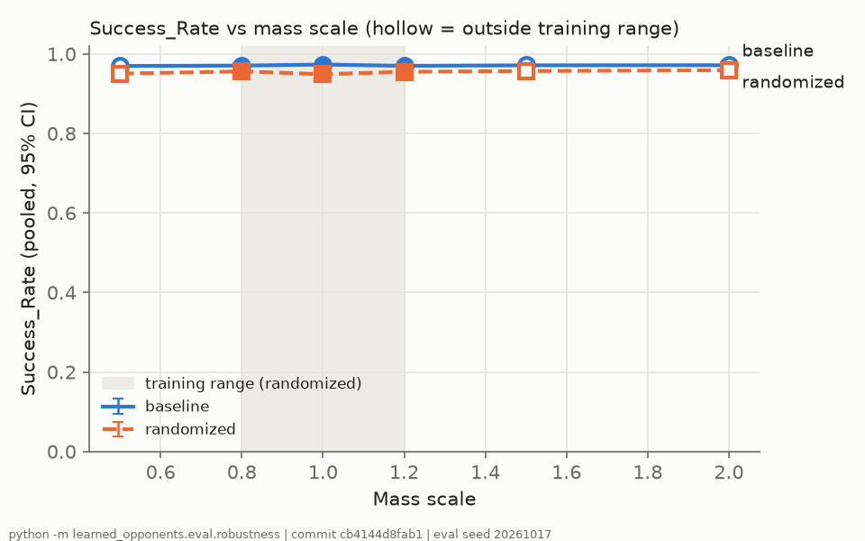
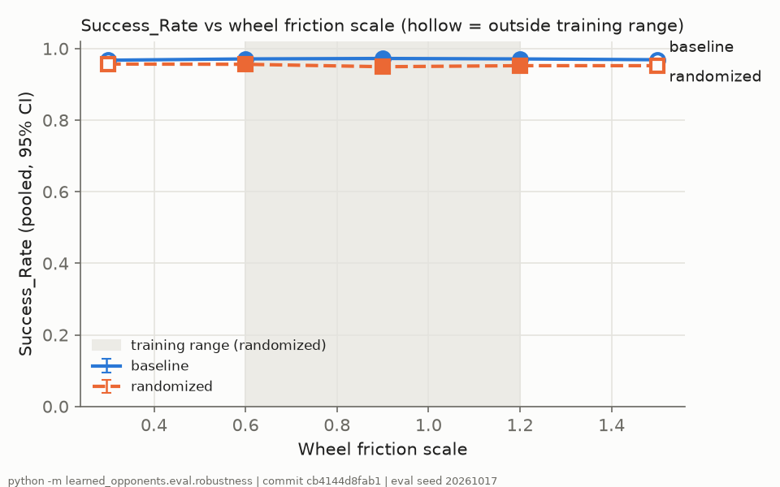
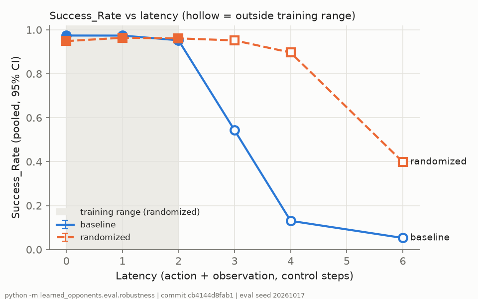
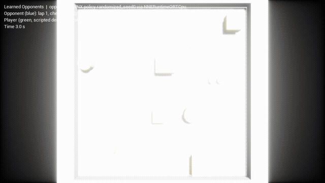

# Learned Opponents

A differential-drive robot learns to reach goals among obstacles with PPO in a GPU-parallel
MuJoCo Warp simulation, in two variants: a **baseline** trained at fixed physical parameters and a
**domain-randomized** variant. Both are evaluated on a robustness grid of perturbed mass, wheel
friction, and latency, exported to ONNX, and run inside an Unreal Engine 5.8 racing game as the
opponent, where an automated transfer check measures the sim-to-sim gap.

**Research question.** How much does domain randomization improve robustness to physical
perturbations, including values outside the training ranges, and how large is the transfer gap when
the same policy drives a robot inside a game engine?

Every result below is generated by a repository command. The result sections are copied verbatim
from [`results/summary.md`](results/summary.md) by `python -m learned_opponents.eval.readme` and name
their command, seeds, and full commit hash; the few figures in the Method section cite their source
file and commit. Nothing is typed by hand.

## Method

- **Engine-independent observation and action** ([`learned_opponents/spec/spec.md`](learned_opponents/spec/spec.md)):
  24 horizontal range rays (360 degrees, 4 m), goal direction and distance in the robot frame, and the
  robot's forward speed and yaw rate, normalized to fixed ranges; the action is two wheel speeds in
  [-1, 1]. The same rules are implemented in Python (training) and C++ (game), and a fixture test
  checks they agree within 1e-5.
- **Simulator** (M0 smoke test, [`results/smoke_result.json`](results/smoke_result.json)): mjlab /
  MuJoCo Warp was chosen over MuJoCo Playground / MJX because it stepped 5.1x more environments per
  second with rangefinders on the same arena (1,713,585 vs 336,509 env-steps/s at 4096 worlds,
  commit `a7c5aec6769299913c1e38f8950bdbdea072d269`; details in [`docs/ENVIRONMENT.md`](docs/ENVIRONMENT.md)).
- **Environment** ([`learned_opponents/env/`](learned_opponents/env)): 4096 parallel 8 m x 8 m arenas
  with 4-8 random box and cylinder obstacles, a wheeled robot driven by velocity-controlled wheels,
  episodes ending on reaching the goal (0.25 m), touching an obstacle or wall, or after 20 s.
  Reward: progress toward the goal, +10 on success, -10 on collision.
- **Domain randomization** ([`config/domain_rand.yaml`](config/domain_rand.yaml)): per episode, mass
  x[0.8, 1.2], wheel friction x[0.6, 1.2], motor strength x[0.8, 1.2], ray noise sigma [0, 5 cm],
  action and observation latency [0, 2] control steps.
- **Training** ([`config/train.yaml`](config/train.yaml)): rsl-rl PPO, a 256x256 ELU MLP with a Beta
  action distribution (support exactly [-1, 1]) and learned observation normalization; the same
  budget (30,081,024 environment steps, 306 PPO iterations, about 4-7 minutes per run) and
  hyperparameters for both variants, 3 seeds each. The budget comes from a pilot run on a separate
  seed (below).
- **Evaluation**: deterministic actions on 1024 fixed layouts per training seed, pooled over 3 seeds
  (Wilson intervals for rates, t intervals for times); the robustness grid varies one parameter at a
  time with the others nominal.
- **Export and game**: each policy (normalization, MLP, Beta mean, clip) is exported to ONNX and run
  in Unreal through NNE with the ONNX Runtime CPU backend. The in-game robot is kinematic with the
  same wheel geometry, moves with swept collision against exact box and capsule shapes, and builds its
  observation from in-engine line traces.

## Findings

Every number here comes from the generated result sections below, which carry their commands,
seeds, and commits.

- **Nominal.** The baseline reaches a pooled Success_Rate of 0.973 [0.967, 0.978] over 3072
  episodes, above the 0.80 target; the randomized variant reaches 0.949 [0.941, 0.956]. Randomization
  costs about 2.4 points at nominal parameters.
- **Mass and friction.** Across mass x0.5 to x2.0 and wheel friction x0.3 to x1.5, including values
  outside the training ranges, both variants stay within about 1 point of their own nominal rates,
  and the baseline stays 1.1 to 2.4 points ahead in every cell, so randomization buys nothing there.
  A likely reason (not tested separately) is that the velocity-controlled wheels have torque to spare,
  so mass and friction change little about how the robot moves.
- **Latency.** This is where randomization pays off. Outside the training range the baseline
  collapses (3 steps: 0.543, 4 steps: 0.131, 6 steps: 0.053) while the randomized variant holds 0.952
  at 3 steps and 0.896 at 4, and falls to 0.398 at 6.
- **Transfer to Unreal.** On the same 150 episodes per variant, the in-game Success_Rate is 0.980
  (baseline) and 0.940 (randomized) against 0.993 and 0.953 in MuJoCo: a Transfer_Gap of +0.013 for
  both. The gap is small for both variants and randomization does not reduce it; with 150 episodes the
  per-engine intervals are 5 to 8 points wide, so the two gaps are not distinguishable.

<!-- BEGIN summary:Nominal evaluation: baseline -->
## Nominal evaluation: baseline

- Command: `python -m learned_opponents.eval.robustness --nominal --variants baseline randomized --repeats 2`
- Commit: `cd46c553551e1fa2caba498bbd2e5b56a2ffe9fb`
- Training seeds: 0, 1, 2; training commits: seed 0 `aaea9496f2538fe1bcc4d4b1c093d275bdf34f1f`, seed 1 `aaea9496f2538fe1bcc4d4b1c093d275bdf34f1f`, seed 2 `aaea9496f2538fe1bcc4d4b1c093d275bdf34f1f`
- Evaluation seed 20261017, 1024 episodes per training seed, deterministic actions, nominal domain parameters

| Seed | Episodes | Success_Rate [95% CI] | Collision_Rate [95% CI] | Timeouts | Mean Time_To_Goal [95% CI] |
| --- | --- | --- | --- | --- | --- |
| 0 | 1024 | 0.974 [0.962, 0.982] | 0.006 [0.003, 0.013] | 21 | 5.06 [4.96, 5.17] s |
| 1 | 1024 | 0.964 [0.951, 0.974] | 0.008 [0.004, 0.015] | 29 | 5.10 [4.99, 5.21] s |
| 2 | 1024 | 0.982 [0.972, 0.989] | 0.005 [0.002, 0.011] | 13 | 5.11 [5.00, 5.22] s |
| pooled | 3072 | 0.973 [0.967, 0.978] | 0.006 [0.004, 0.010] | 63 | 5.09 [5.03, 5.15] s |

Target `nominal_success_target` = 0.80: pooled Success_Rate 0.973 -> **met**.
Evaluation reproducibility: each checkpoint was evaluated 3 times on the same evaluation seed (the table shows the first). Success counts per repeat: seed 0: [997, 997, 997]; seed 1: [987, 987, 988]; seed 2: [1006, 1008, 1006]. Measured evaluation tolerance (largest spread in a seed's Success_Rate): **0.0020**. Repeats are not bit-identical because MuJoCo Warp accumulates with floating-point atomics, so borderline episodes can flip.
<!-- END summary:Nominal evaluation: baseline -->

<!-- BEGIN summary:Nominal evaluation: randomized -->
## Nominal evaluation: randomized

- Command: `python -m learned_opponents.eval.robustness --nominal --variants baseline randomized --repeats 2`
- Commit: `cd46c553551e1fa2caba498bbd2e5b56a2ffe9fb`
- Training seeds: 0, 1, 2; training commits: seed 0 `aaea9496f2538fe1bcc4d4b1c093d275bdf34f1f`, seed 1 `aaea9496f2538fe1bcc4d4b1c093d275bdf34f1f`, seed 2 `aaea9496f2538fe1bcc4d4b1c093d275bdf34f1f`
- Evaluation seed 20261017, 1024 episodes per training seed, deterministic actions, nominal domain parameters

| Seed | Episodes | Success_Rate [95% CI] | Collision_Rate [95% CI] | Timeouts | Mean Time_To_Goal [95% CI] |
| --- | --- | --- | --- | --- | --- |
| 0 | 1024 | 0.964 [0.951, 0.974] | 0.018 [0.011, 0.028] | 19 | 5.18 [5.07, 5.29] s |
| 1 | 1024 | 0.934 [0.917, 0.947] | 0.032 [0.023, 0.045] | 35 | 5.17 [5.06, 5.28] s |
| 2 | 1024 | 0.950 [0.935, 0.962] | 0.007 [0.003, 0.014] | 44 | 5.22 [5.10, 5.33] s |
| pooled | 3072 | 0.949 [0.941, 0.956] | 0.019 [0.015, 0.024] | 98 | 5.19 [5.13, 5.26] s |

Target `nominal_success_target` = 0.80: pooled Success_Rate 0.949 -> **met**.
Evaluation reproducibility: each checkpoint was evaluated 3 times on the same evaluation seed (the table shows the first). Success counts per repeat: seed 0: [987, 986, 986]; seed 1: [956, 957, 956]; seed 2: [973, 972, 973]. Measured evaluation tolerance (largest spread in a seed's Success_Rate): **0.0010**. Repeats are not bit-identical because MuJoCo Warp accumulates with floating-point atomics, so borderline episodes can flip.
<!-- END summary:Nominal evaluation: randomized -->

<!-- BEGIN summary:Robustness at a glance -->
## Robustness at a glance

- Command: `python -m learned_opponents.eval.robustness `; commit `cb4144d8fab1d871d070eace89e18591aaed3b11`; evaluation seed 20261017; 1024 episodes per training seed per cell, pooled over 3 seeds per variant (full table with collision rates, times, and per-seed rates under "Robustness grid").

| Parameter | Value | Range | Baseline Success_Rate [95% CI] | Randomized Success_Rate [95% CI] | Randomized - baseline |
| --- | --- | --- | --- | --- | --- |
| Mass scale | 0.5 | out | 0.970 [0.963, 0.975] | 0.951 [0.942, 0.958] | -0.019 |
| Mass scale | 0.8 | in | 0.971 [0.964, 0.976] | 0.956 [0.948, 0.963] | -0.015 |
| Mass scale | 1 | in | 0.973 [0.967, 0.978] | 0.949 [0.941, 0.956] | -0.024 |
| Mass scale | 1.2 | in | 0.970 [0.963, 0.976] | 0.955 [0.947, 0.962] | -0.015 |
| Mass scale | 1.5 | out | 0.971 [0.965, 0.977] | 0.957 [0.949, 0.964] | -0.014 |
| Mass scale | 2 | out | 0.972 [0.965, 0.977] | 0.959 [0.951, 0.965] | -0.013 |
| Wheel friction scale | 0.3 | out | 0.967 [0.961, 0.973] | 0.957 [0.949, 0.963] | -0.011 |
| Wheel friction scale | 0.6 | in | 0.971 [0.964, 0.976] | 0.956 [0.948, 0.963] | -0.015 |
| Wheel friction scale | 0.9 | in | 0.972 [0.966, 0.978] | 0.949 [0.941, 0.956] | -0.023 |
| Wheel friction scale | 1.2 | in | 0.971 [0.964, 0.976] | 0.952 [0.944, 0.959] | -0.019 |
| Wheel friction scale | 1.5 | out | 0.969 [0.962, 0.974] | 0.952 [0.944, 0.959] | -0.017 |
| Latency | 0 | in | 0.974 [0.968, 0.979] | 0.949 [0.940, 0.956] | -0.025 |
| Latency | 1 | in | 0.974 [0.967, 0.979] | 0.964 [0.957, 0.970] | -0.010 |
| Latency | 2 | in | 0.952 [0.944, 0.959] | 0.961 [0.953, 0.967] | +0.008 |
| Latency | 3 | out | 0.543 [0.525, 0.561] | 0.952 [0.944, 0.959] | +0.409 |
| Latency | 4 | out | 0.131 [0.119, 0.143] | 0.896 [0.885, 0.907] | +0.766 |
| Latency | 6 | out | 0.053 [0.045, 0.061] | 0.398 [0.381, 0.416] | +0.346 |
<!-- END summary:Robustness at a glance -->

Robustness plots (`results/robustness_<parameter>.png`, same command and commit):

| Mass | Wheel friction | Latency |
| --- | --- | --- |
|  |  |  |

The full grid (collision rates, times to goal, per-seed rates) is in [`results/summary.md`](results/summary.md).

<!-- BEGIN summary:Transfer check (MuJoCo vs Unreal, same layouts) -->
## Transfer check (MuJoCo vs Unreal, same layouts)

- Command: `powershell -File scripts/run_transfer.ps1`
- Commit: `9aed9521952e633b73c8b7c76e2a76aa190063da`
- 50 layouts from `results/transfer/episodes.json` (layout seed 50505) x 3 training seeds per variant, nominal parameters, deterministic actions; the game runs headless and steps each episode at control_dt_s.
- Transfer_Gap = MuJoCo Success_Rate - in-game Success_Rate on the same episodes, reported as measured (nothing tuned to shrink it).

| Variant | Episodes | MuJoCo Success_Rate [95% CI] | In-game Success_Rate [95% CI] | Transfer_Gap | In-game Collision_Rate [95% CI] |
| --- | --- | --- | --- | --- | --- |
| baseline | 150 | 0.993 [0.963, 0.999] | 0.980 [0.943, 0.993] | +0.013 | 0.013 [0.004, 0.047] |
| randomized | 150 | 0.953 [0.907, 0.977] | 0.940 [0.890, 0.968] | +0.013 | 0.040 [0.018, 0.085] |
<!-- END summary:Transfer check (MuJoCo vs Unreal, same layouts) -->

## Gameplay

*Blue: the exported policy (`randomized_seed0.onnx`) running in Unreal through NNE. Green: the
player robot, driven here by a scripted demo controller (`-LODemoPlayer`) so the clip is
reproducible; in play it is driven with W/A/S/D. Recorded by `scripts/capture_gif.ps1`.*

<!-- BEGIN summary:Training budget selection (pilot, never reported as a result) -->
## Training budget selection (pilot, never reported as a result)

- Command: `python -m learned_opponents.train.pilot curve` after `python -m learned_opponents.train --variant baseline --seed 100 --out runs/pilot/curve --force --set train.training_budget_steps=200000000 --checkpoint-every-steps 10000000`
- Commit: `ad6c76362a5071ad808ea370a58dd18a68ff0c01` (pilot trained at `e825028f3c4be157bd3dd511d6d5fea71b29fa12`)
- Pilot seed 100, baseline variant; each checkpoint evaluated at nominal parameters on 4096 layouts from the pilot seed's evaluation stream (not the reported evaluation seed).
- Rule (design "Choosing the budget"): among the curve checkpoints that the pilot reached within ``max_minutes_per_run``, take the best nominal Success_Rate; the budget is the smallest checkpoint whose rate is within ``TOLERANCE`` of that best and at least ``nominal_success_target``. If none reaches the target, the best checkpoint is used and the shortfall is reported.

| Env steps | Wall time | Success_Rate [95% CI] | Collisions | Timeouts |
| --- | --- | --- | --- | --- |
| 10,027,008 | 1.1 min | 0.962 [0.956, 0.967] | 36 | 120 |
| 20,054,016 | 2.2 min | 0.966 [0.960, 0.971] | 27 | 111 |
| 30,081,024 | 3.3 min | 0.972 [0.966, 0.976] | 25 | 91 |
| 40,009,728 | 4.3 min | 0.969 [0.963, 0.973] | 16 | 113 |
| 50,036,736 | 5.5 min | 0.965 [0.959, 0.970] | 29 | 115 |
| 60,063,744 | 6.8 min | 0.969 [0.963, 0.974] | 23 | 103 |
| 70,090,752 | 7.9 min | 0.977 [0.972, 0.981] | 8 | 86 |
| 80,019,456 | 9.2 min | 0.967 [0.961, 0.972] | 14 | 123 |
| 90,046,464 | 10.3 min | 0.966 [0.960, 0.971] | 27 | 112 |
| 100,073,472 | 11.3 min | 0.977 [0.972, 0.981] | 13 | 80 |
| 110,002,176 | 12.4 min | 0.981 [0.976, 0.984] | 38 | 41 |
| 120,029,184 | 13.5 min | 0.972 [0.967, 0.977] | 34 | 80 |
| 130,056,192 | 14.5 min | 0.970 [0.964, 0.975] | 16 | 108 |
| 140,083,200 | 15.6 min | 0.965 [0.959, 0.970] | 13 | 130 |
| 150,011,904 | 16.7 min | 0.970 [0.964, 0.975] | 32 | 91 |
| 160,038,912 | 17.8 min | 0.976 [0.971, 0.980] | 27 | 72 |
| 170,065,920 | 18.9 min | 0.972 [0.966, 0.977] | 20 | 95 |
| 180,092,928 | 20.0 min | 0.975 [0.970, 0.979] | 15 | 88 |
| 190,021,632 | 21.0 min | 0.976 [0.971, 0.980] | 19 | 79 |
| 200,048,640 | 22.3 min | 0.976 [0.971, 0.981] | 12 | 85 |

Chosen `training_budget_steps` = **30,081,024** (Success_Rate 0.972; best 0.981; target met).
Earlier pilot evidence (stopped runs and why): `docs/evidence/pilot/README.md`, `docs/evidence/pilot/pilot1_entropy0.005_checkpoints.json`, `docs/evidence/pilot/pilot1_entropy0.005_config.yaml`, `docs/evidence/pilot/pilot1_entropy0.005_train_log.csv`, `docs/evidence/pilot/pilot2_entropy0_checkpoints.json`, `docs/evidence/pilot/pilot2_entropy0_config.yaml`, `docs/evidence/pilot/pilot2_entropy0_train_log.csv`
<!-- END summary:Training budget selection (pilot, never reported as a result) -->

<!-- BEGIN summary:Training reproducibility (pilot, never reported as a result) -->
## Training reproducibility (pilot, never reported as a result)

- Command: `python -m learned_opponents.train.pilot repro`
- Commit: `aaea9496f2538fe1bcc4d4b1c093d275bdf34f1f`
- Pilot seed 100 trained twice with the frozen config; each run evaluated at nominal parameters on evaluation seed pilot evaluation stream of seed 100 (4096 episodes)

| Run | Success_Rate [95% CI] | Wall time |
| --- | --- | --- |
| repro_a | 0.975 [0.970, 0.979] | 4.9 min |
| repro_b | 0.979 [0.974, 0.983] | 4.1 min |

Measured training reproducibility tolerance on this GPU (absolute difference in nominal Success_Rate between the two runs): **0.004**.
<!-- END summary:Training reproducibility (pilot, never reported as a result) -->

## Reproducing the numbers

Machine setup, exact versions, and evidence: [`docs/ENVIRONMENT.md`](docs/ENVIRONMENT.md). Python
runs inside WSL (`Ubuntu-24.04`) with `~/.venvs/learned-opponents`; Unreal commands run in
Windows PowerShell. Each step below is one command.

| Result | Command |
| --- | --- |
| Framework choice (M0) | `bash scripts/smoke_test.sh` |
| Project environment | `bash scripts/make_project_venv.sh` |
| Pilot budget and reproducibility | `bash scripts/pilot_curve.sh`, then `bash scripts/pilot_repro.sh` |
| All six training runs | `bash scripts/train_all.sh` (one run: `python -m learned_opponents.train --variant baseline --seed 0`) |
| Nominal evaluation | `python -m learned_opponents.eval.robustness --nominal --variants baseline randomized --repeats 2` |
| Robustness grid, plots, summary | `python -m learned_opponents.eval.robustness` |
| ONNX export and parity fixtures | `python -m learned_opponents.export.to_onnx --all` |
| Game data (task config, fixtures, course) | `bash scripts/make_obs_fixtures.sh` |
| Unreal build and maps | `scripts\build_game.ps1`, `scripts\create_maps.ps1` |
| Transfer check | `scripts\run_transfer.ps1` |
| Gameplay GIF | `scripts\capture_gif.ps1` |
| README result blocks | `python -m learned_opponents.eval.readme` |

## Tests

| Suite | Command |
| --- | --- |
| Full Python suite (WSL, GPU tests included) | `~/.venvs/learned-opponents/bin/python -m pytest` |
| CI suite (no GPU; GitHub Actions runs it on every push) | `pytest -m "not gpu"` |
| Parity, Python policy vs ONNX Runtime, all six models | `python -m learned_opponents.export.parity` |
| Unreal automation tests (observation builder, traced ranges, kinematics, NNE parity) | `powershell -NoProfile -ExecutionPolicy Bypass -File scripts\run_ue_tests.ps1` |

Property-based tests (Hypothesis, 100-300 examples each) cover the observation and action layout,
reset, termination, reward, randomization ranges and reproducibility, confidence intervals, the
grid's out-of-range values, ONNX parity, and the transfer gap; the C++ observation builder is checked
against 128 Python-generated cases.

## Known limitations

- **Sim-to-sim, not sim-to-real.** The transfer check moves from MuJoCo to a game engine, not to
  hardware.
- **Domain randomization may not close the transfer gap.** Whether it does is a measured outcome,
  reported as-is.
- **Different dynamics in the game.** The in-game robot is kinematic, so mass, friction, and motor
  strength have no in-game counterpart, and its velocity observation is the commanded velocity, with
  none of MuJoCo's acceleration lag; the gap mixes raycast, collision, and dynamics differences.
- **Small transfer sample.** 150 in-game episodes per variant give intervals 5 to 8 points wide, so
  gaps of this size (+0.013) cannot be told apart between the variants.
- **Determinism is bounded.** MuJoCo Warp accumulates with floating-point atomics, so repeated GPU
  rollouts are not bit-identical; the measured evaluation and training tolerances are reported next to
  the results.
- **Hyperparameters tuned on the baseline pilot.** The budget and PPO settings (including the switch to
  a Beta distribution after two Gaussian pilots drifted) were chosen on a baseline pilot seed and
  reused for the randomized variant, which may favor the baseline slightly.
- **Seed-to-seed variation.** Pooled intervals describe episode sampling with 3 seeds per variant;
  per-seed rates are listed so training variability stays visible.
- **Layouts are not checked for a free path.** A rare layout whose obstacles wall off the goal counts
  as a failure for every policy.
- **Solver constants after mass changes.** Randomized mass updates subtree masses but keeps MuJoCo's
  reference inverse weights (constraint regularization) at the nominal model's values.

## Repository

Portfolio project; no license is granted. Third-party packages and licenses:
[`THIRD_PARTY.md`](THIRD_PARTY.md).
